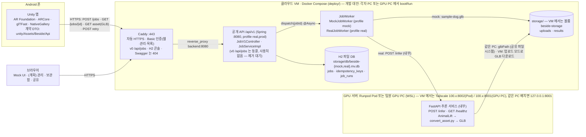
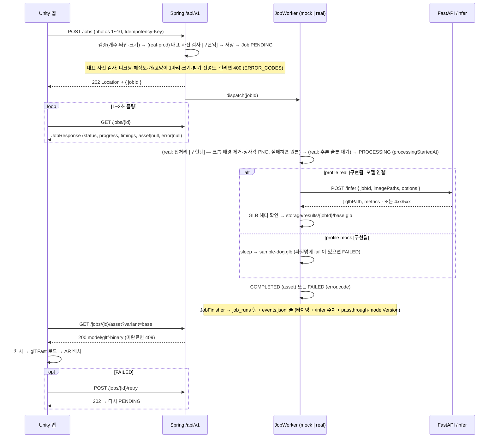
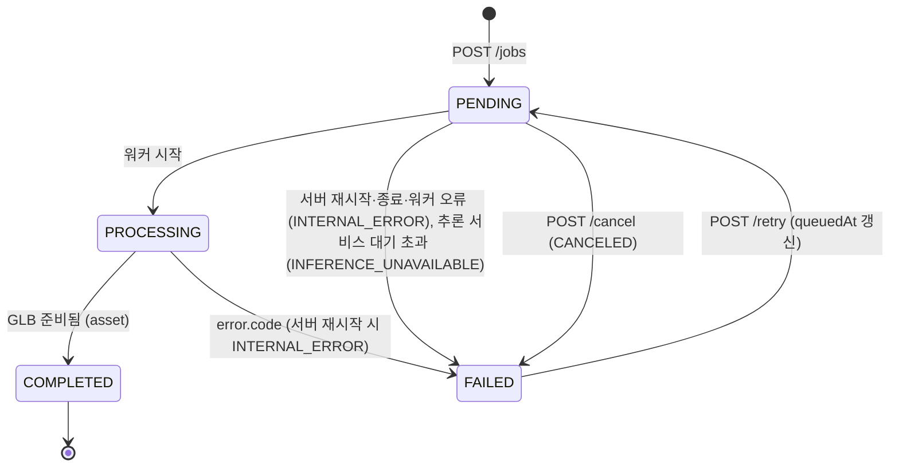

# 아키텍처

결정됨(재논의하지 않는다): **Unity Android 앱(ARCore, glTFast) ↔ Spring Boot 공개 API(Job 상태·저장·에셋 서빙) ↔ Python 추론 서비스(FastAPI, GPU, AnimalLift + GLB 변환, 내부 전용 `POST /infer`)**. Spring 은 profile 로 `mock | real` 워커를 교체하고 real 워커가 Python 을 호출한다. Unity 는 Spring API 계약 v1 만 본다.

왜 세 부분으로 나눴나:
- 처음 결정한 이유를 적은 기록은 없다. 아래는 2026-11-26 에 설계와 운영 기록에서 읽어 낸 것이다. 팀 확인은 [계획]이다.
- 모델(AnimalLift)은 PyTorch 라 추론은 Python 서비스에 둔다.
- GPU 는 비싸서 쓸 때만 켠다. 그래서 작업 상태·결과·공개 API 는 GPU 가 꺼져도 살아 있어야 한다(prod 오프라인 대기, '데이터 흐름').
- 세 트랙이 동시에 개발하므로 경계를 계약 문서(`docs/api/openapi.yaml`, GLB_SPEC)와 계약 시험으로 고정한다. Unity 가 Python 을 직접 부르지 않는 것도 같은 이유다(경계를 하나로).

상태: Spring(v0·v1·Mock/real 워커·H2 저장소·실행별 측정 `job_runs`)과 계약 문서는 **[구현됨]**(real 워커의 `/infer` 호출은 FastAPI 스텁 패스스루로 확인), Unity 앱과 AnimalLift 추론·변환·자동 리깅 연결은 #1(2026-10-14)로 머지됐다 — 앱 DoD 증빙은 아직 없고, 실제 모델 실측은 2026-11-17 Runpod 에서 처음 했다([exp-01](../generation/experiments/2026-11-17_exp-01_baseline-runpod.md), [PLAN.md](PLAN.md)). 실제 E2E 배치는 팀원 GPU PC 한 대에 Spring 과 추론 서비스를 함께 두기로 했다(2026-10-05). 2026-10-30 결정으로 Spring 은 **클라우드 VM**(Docker Compose + Caddy)에 올리고 GPU 쪽과는 Tailscale 로 잇는다: 배포 파일·prod 프로파일·`/infer` 업로드 모드·GPU 오프라인 대기는 **[구현됨]**([deploy/](../deploy/README.md), 같은 PC 패스스루로 확인), 실제 VM 배포는 2026-11-13 GCP 로 **[구현됨]**. GPU 는 **Runpod Pod** 로 하고 Pod 안에 Tailscale 을 띄우기로 했고(2026-11-13), 2026-11-17 VM ↔ Pod 연결과 AnimalLift 모델 모드로 공개 주소 전체 흐름이 **[구현됨]**(사진 3건. 그날 VM ↔ Pod 는 DERP 중계였고, 2026-11-18·19 부하 시험 때는 직접 연결이었다. 아래 '배포 가정').

## 구성 요소

VM 배치 기준이다. 같은 PC 배치(개발·대안)에서는 Caddy 없이 폰이 `http://<PC IP>:8080` 으로 Spring 에 바로 붙고, 추론 서비스는 같은 PC 의 127.0.0.1:8001 이다.



## 데이터 흐름



## Job 상태 머신



서버가 다시 시작되면 PENDING/PROCESSING 으로 남은 작업은 FAILED(`INTERNAL_ERROR`)가 된다. 작업 기록은 H2 에 남지만 워커 스레드는 남지 않기 때문이며, 앱은 retry 로 다시 실행한다 (`InterruptedJobRecovery`, 웹 서버가 요청을 받기 전에 실행).

워커 안에서 예상하지 못한 예외가 나도 아직 끝나지 않은 작업(PENDING·PROCESSING)은 그 자리에서 FAILED(`INTERNAL_ERROR`)가 된다 **[구현됨]** (2026-11-20). 전에는 PROCESSING 전 구간(작업 읽기·전처리·추론 서비스 확인·PROCESSING 저장)의 예외가 워커 밖으로 나가 작업이 재시작 때까지 PENDING 에 남았다. 실패 기록마저 쓰지 못하면(DB 오류) 로그만 남기고, 다음 시작 때 `InterruptedJobRecovery` 가 닫는다.

`timings.queuedMs` 는 PENDING 구간, `processingMs` 는 PROCESSING 구간, `totalMs` 는 접수(또는 retry)부터 종료까지. 상태는 결과 메타데이터를 채운 뒤 마지막에 바꾼다.

## 프로파일

| | `mock` (기본, `spring.profiles.default`) | `real` |
|---|---|---|
| 워커 | `MockJobWorker`: 고정 지연 후 샘플 GLB. 파일명 `fail` 트리거 | `RealJobWorker`: 추론 슬롯 대기 → `POST {inference.base-url}/infer` → 결과 GLB 복사 **[구현됨]**. AnimalLift 연결은 #1 로 머지, 실측은 [exp-01](../generation/experiments/2026-11-17_exp-01_baseline-runpod.md)·VM 부하 시험 2~4차 **[실험 결과]**. GPU 없이 시험할 때는 FastAPI 패스스루 |
| 설정 파일 | `application-mock.properties` (`mock.worker.*`, `storage.result.sample`) | `application-real.properties` (`inference.base-url`, `inference.timeout-ms` 기본 120 s(2026-11-21 #7, 전에는 600 s), `inference.max-concurrency`, `inference.transfer`, `storage.result.dir`) |
| GPU | 불필요 | FastAPI 추론 서비스가 같은 GPU PC 에서 실행(`scripts/run_real.ps1`). VM 배치에서는 Tailscale 너머의 Runpod Pod 또는 GPU PC([deploy/README.md](../deploy/README.md), 업로드 모드 [구현됨], VM ↔ Runpod Pod 연결 [구현됨] 2026-11-17, VM ↔ GPU PC [계획]) |
| 용도 | Unity·브라우저 개발, 계약 테스트, 데모 백업 | Spring↔Python 연동 시험(패스스루), 실제 모델 E2E(10-20 주 선행), 4단계 실 연동 |
| healthz | `{ "profile": "mock", "workerType": "mock" }` | `{ "profile": "real", "workerType": "real" }` |
| DB 파일 | `storage/db/beside-mock.mv.db` (+ `/h2-console`) | `storage/db/beside-real.mv.db` (+ `/h2-console` — `job_runs` 측정표 내보내기, METRICS §1.1) |

실행: `.\gradlew.bat bootRun` / `.\gradlew.bat bootRun --args="--spring.profiles.active=real"`.

## 저장소 레이아웃

```text
backend/storage/
├─ db/beside-mock.mv.db               # H2, profile mock (gitignore): 테이블 jobs · idempotency_keys · job_runs(실행별 측정)
├─ db/beside-real.mv.db               # H2, profile real (gitignore): 같은 테이블 3개 — 측정표는 이 파일에서
├─ uploads/{jobId}_{원본파일명}        # 업로드 사진 (gitignore). 같은 이름이면 -2, -3 접미사
├─ results/sample-dog.glb             # Mock 샘플 — 현재 0바이트, 유효 GLB 로 교체(직접 할 일)
├─ results/{jobId}/base.glb           # real 결과 [구현됨] — /infer 의 GLB 를 복사 (gitignore). hair GLB 는 없다(2026-11-21 #4), 털 맵은 이 GLB 안
├─ preprocessed/{jobId}-{설정해시}.png # real 전처리 결과(정사각 RGBA, /infer 의 첫 사진) [구현됨] (gitignore)
└─ events.jsonl                       # 측정 로그, 실행이 끝날 때마다 한 줄 (METRICS §1, gitignore)
```

서버 내부 경로는 어떤 API 응답에도 나가지 않는다. v1 은 `asset.url`(상대 경로)만 준다.

## 배포 가정

결정(2026-10-30): Spring 은 **클라우드 VM 한 대**, GPU 추론은 **팀원 GPU PC** 에 남기고 **Tailscale** 사설망으로 잇는다. 팀 내부 테스트용이라 계정은 없고 웹·관리 경로만 Basic 인증으로 막는다. 같은 PC 배치(2026-10-05 결정)는 개발과 대안으로 남는다.

결정(2026-11-13): GPU 추론은 **Runpod Pod** 에서 한다(학교 재료비로 2026-11-17 크레딧 약 $200 구매, 팀원 GPU PC 는 대안). Pod 는 컨테이너라 Tailscale 을 **Pod 안에 userspace 모드**로 띄우고 추론 서비스는 127.0.0.1 에만 연다. 다른 두 방법을 쓰지 않는 이유: Runpod HTTP 프록시는 요청을 100초에서 끊는데 Spring 은 `/infer/upload` 를 최대 120초(`inference.timeout-ms`, 2026-11-21 #7 로 600초에서 줄임) 기다리고, Pod 의 TCP 포트를 공개하면 사진·토큰이 암호화 없이 지나가며 Pod 를 다시 켤 때마다 외부 포트가 바뀐다. 절차는 [deploy/README.md](../deploy/README.md) 'Runpod Pod 쪽'.

| 배치 | 용도 | 상태 |
|---|---|---|
| **클라우드 VM**: Docker Compose(Caddy + Spring `real,prod`), 볼륨 `beside-storage` | 팀 테스트·시연. 폰은 어디서나 `https://beside-team.duckdns.org` | **[구현됨]** 배포 파일(`backend/Dockerfile`, `deploy/`, `scripts/deploy_vm.sh`), CI(이미지 빌드·Caddy 경로 시험, main push·PR #4 통과), GCP VM 실제 배포(2026-11-13: e2-standard-2 서울, HTTPS·Basic 인증·전체 흐름·재부팅 복구, [기록](deploy/2026-11-13_gcp-first-deploy.md)). Tailscale·Runpod Pod 연결과 AnimalLift 모델 모드 **[구현됨]**(2026-11-17, A40 EU-SE-1, 사진 3건, [기록](deploy/2026-11-17_runpod-connect.md)). VM ↔ Pod 는 2026-11-18·19 직접 연결이었다(11-17 은 DERP) **[실험 결과]**. 폰 앱 시험은 **[계획]**. prod 프로파일·업로드 모드·오프라인 대기·H2 온라인 백업 **[구현됨]** |
| GPU PC 한 대에 Spring + 추론 서비스 | 실제 모델 개발·측정, VM 을 쓸 수 없을 때의 대안 | **[구현됨]** `scripts/run_real.ps1`, 경로 모드 |
| 각자 PC, profile mock | Unity·브라우저 개발, 계약 테스트 | **[구현됨]** |

- VM([deploy/README.md](../deploy/README.md)):
  - 밖에서는 Caddy 의 80/443 만 열린다. 자동 HTTPS(Let's Encrypt), 요청 본문 25MB. Spring 8080 은 compose 내부망에만 연다.
  - VM 은 GCP Compute Engine `beside-vm`(asia-northeast3-a, e2-standard-2 = 2 vCPU·8GB, 무료 체험 크레딧, 2026-11-12 결정). 체험 계정은 GPU 를 붙일 수 없어 추론은 GCP 밖에 둔다.
  - Caddy 설정이 v0 `/api/jobs*`, `/h2-console*`, `/swagger*`, `/v3/api-docs*`, `/webjars*`, `;` 가 든 경로를 404 로 막는다 **[구현됨]**(CI 와 공개 주소에서 확인)(v0 코드는 동결이라 배포 설정에서 막는다. REVIEW_CHECKLIST #10·#13 은 2026-11-21 에 이대로 유지로 결정, v0 코드 삭제는 Unity 1단계 실기기 확인 뒤).
  - Basic 인증: 웹 화면(`/`, Mock UI 파일 — 끝에 `/` 를 붙인 경로도, 관리·보관함·작업 상세), `/api/v1/jobs` 의 POST 가 아닌 method(목록, #9 — 2026-11-21 유지로 결정), `/api/v1/jobs/*` 의 GET·HEAD·POST 가 아닌 method(삭제 등), `/api/v1/jobs/*/pet*`, `/api/v1/admin*`, `/api/v1/pets*`. 응답에 HSTS 를 붙이고, 손님이 보낸 `Forwarded`·`X-Forwarded-Prefix` 는 Spring 에 넘기지 않는다(2026-11-13 첫 배포 감사 뒤).
  - 공개: 앱 API(업로드·상태·에셋·retry), `/api/v1/healthz`, 공유 링크. 작업은 id(UUID)를 아는 사람만 볼 수 있다는 가정이다.
  - Spring ↔ Python: 공유 파일시스템이 없으므로 `/infer` 업로드 모드(사진 업로드 + GLB 다운로드, `inference.transfer=upload`, 토큰 `inference.token` ↔ GPU 쪽 `BESIDE_INFERENCE_TOKEN`)로 보낸다 — **[구현됨]**(같은 PC 패스스루 e2e, VM 안 스텁, 그리고 2026-11-17 VM ↔ Runpod Pod 로 확인). 2026-11-21 에 REVIEW_CHECKLIST #6 (b) 로 결정했다: 사진 멀티파트 `POST /infer/upload` → JSON `glbUrl` → `GET`/`DELETE /artifacts/{jobId}`, 경로 모드는 같은 호스트용으로 남김. 추론 서비스는 GPU PC 에서는 그 PC 의 Tailscale IP(`BESIDE_HOST`)에, Runpod Pod 에서는 127.0.0.1 에만 바인드한다(userspace 모드의 tailscaled 가 자기 100.x 로 온 연결을 127.0.0.1 의 같은 포트로 넘긴다 — Tailscale 소스 `wgengine/netstack` 로 확인했고, 2026-11-17 실제 Pod 로그에서도 요청이 127.0.0.1 에서 들어왔다 **[구현됨]**).
  - 데이터: H2 파일·업로드·결과 GLB·`events.jsonl` 은 볼륨 `beside-storage`(컨테이너 `/app/storage`)에 있다. prod 는 매시 5분(한국 시각) H2 온라인 백업(`BACKUP TO` → `storage/backup/`, 최신 48개. 2026-11-20 까지는 매일 04:30·7개) **[구현됨]**(VM 반영 2026-11-20 05:33 UTC **[구현됨: 적용]**, 같은 날 13:05·14:05·15:05 UTC zip 확인). 이 zip 과 사진·GLB 를 VM 밖 GCS 버킷으로 올리는 것은 [deploy/README.md](../deploy/README.md) '운영 대응 설치' R1 — 파일 [구현됨], 버킷 `beside-514511-backups`·계정·VM 에 붙이기·컨테이너의 메타데이터 차단·매시 20분 업로드 타이머는 2026-11-20 적용 [구현됨: 적용](매시 백업을 VM 에 반영한 05:33 UTC 전에는 버킷에 새로 가는 DB zip 이 하루 1개였고, 그 뒤 매시 1개 — 13:20·14:20·15:20 UTC 확인). VM·zone 유실에는 매일 디스크 스냅샷(R2, 19:00 UTC·7일)을 2026-11-20 적용 [구현됨: 적용]. 볼륨 전체는 backend 를 멈추고 tar 로 묶는다(문서).
  - GPU 쪽(Pod·GPU PC)이 꺼져 있거나 모델이 준비 전이면 prod 는 작업을 PENDING 으로 두고 `/healthz` 를 5초마다 다시 읽다가 UP 이 되면 시작한다. 30분(`inference.offline-wait-ms`)을 넘기면 `INFERENCE_UNAVAILABLE` **[구현됨]**. 30분은 작업을 받은 때부터 센다: 앞 작업 뒤에서 추론 슬롯을 기다린 시간도 들어가므로, GPU 가 계속 꺼져 있으면 여러 건이 쌓여도 각 작업은 받은 지 약 30분에 끝난다(전에는 N번째 작업이 약 N×30분) **[구현됨]**. 작업 종료와 GPU 상태 변화는 Discord 웹훅으로 알린다(`notify.webhook-url`, 선택, 서버 이름 `notify.inference-label`) **[구현됨]**. prod 는 GPU 끊김이 45초(`notify.down-grace-ms`) 넘게 이어질 때만 알린다: VM ↔ Pod 의 Tailscale 중계가 `/healthz` 를 한 번 놓친 일(2026-11-17, 15초 뒤 복구)로 거짓 끊김·연결 두 메시지가 가지 않게 한다. 작업 쪽 대기는 끊김을 곧바로 본다. 재배포로 backend 가 다시 시작되면 진행 중 작업은 FAILED(`INTERNAL_ERROR`)가 된다.
- 개발: 폰과 PC 는 같은 Wi-Fi, `http://<PC IP>:8080`, 방화벽 8080 허용, 앱은 개발용 cleartext 허용. 절차는 [unity/README.md](../unity/README.md).
- GPU PC 한 대 배치(결정 2026-10-05, 이제 개발·대안): Spring 과 추론 서비스를 **팀원 GPU PC 한 대**에 함께 띄운다(`scripts/run_real.ps1`, [backend/README.md](../backend/README.md) 'GPU PC 에 real 배치'). 추론 서비스는 127.0.0.1:8001 에만 묶고 Spring 의 8080 만 LAN 에 연다. 폰은 그 PC 의 IP 로 붙는다(Mock 과 같은 절차). H2 파일·업로드·결과 GLB 도 그 PC 에 있다. 리포는 ASCII·공백 없는 경로에 둔다(한글·공백 경로는 모델 쪽 이미지 로더가 못 읽을 수 있다).
- Spring ↔ Python: 같은 호스트면 경로 모드 **[구현됨]**(`/infer` 가 업로드 경로를 읽고 GLB 경로를 돌려준다). 분리 배포(VM)는 업로드 모드 **[구현됨]**(`inference.transfer=upload`, `InferenceClient`).
- 보안: 계정·로그인 없음(팀 내부 테스트). VM 에서는 HTTPS 와 Basic 인증(위 경로)을 Caddy 가 맡는다 — **[구현됨]**(GCP VM, 2026-11-13). 업로드 바이러스 검사·요청 수 제한은 범위 밖(첫 배포 감사에서도 "요청 수 제한 없음" 이 나왔다 — 부하 시험 때 다시 본다). 요청 제한은 2026-11-21 에 429 `RATE_LIMITED` + `Retry-After` 이름만 예약했다(#22). 키·한도·구현은 큐 상한 적용과 5차 부하 시험 뒤 [계획].
- 동시성: Mock 은 작업마다 스레드(`@Async`, 기본 실행기). real 은 `inference.max-concurrency`(기본 1 = GPU 1장)건만 `/infer` 를 부르고 나머지는 PENDING 으로 기다린다 **[구현됨]**.
- DB: 서버 하나가 H2 파일 하나를 연다(AUTO_SERVER 없음). 같은 파일로 두 번째 서버를 띄우면 시작 단계에서 실패한다. 다른 인스턴스는 `--storage.db.path` 로 다른 파일을 쓴다.

## 계약 경계와 문서

| 경계 | 문서 | 보호 수단 |
|---|---|---|
| Unity ↔ Spring | [api/openapi.yaml](api/openapi.yaml), [api/ERROR_CODES.md](api/ERROR_CODES.md) | `JobV1ContractTest`, `JobV1ApiTest`, Unity DTO |
| Spring ↔ Python | [generation/inference_service/README.md](../generation/inference_service/README.md) | FastAPI 스키마(pydantic), `InferenceClientTest`·`RealJobWorkerTest`(가짜 `/infer`) [구현됨], 실제 모델 통합 테스트 [계획] |
| GLB 파일 | [asset/GLB_SPEC.md](asset/GLB_SPEC.md) | gltf-validator, 변환기 자체 검사, glTFast 로드 |
| 측정 이름 | [METRICS.md](METRICS.md) | 세 트랙 공통 표기 |
