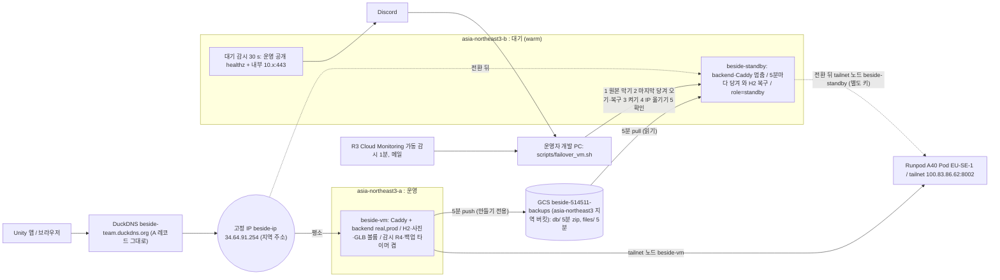

# D1 — 발표 전 9일 안에 끝낼 수 있는, 실제로 넘어가는 warm standby 설계안 (2026-11-25)

## 1. 한 줄 요약과 막는 장애 / 못 막는 장애

**요약**: 대기 VM `beside-standby` 를 다른 zone(asia-northeast3-b)에 하나 둡니다. 백업은 이미 있는 지역 버킷을 5분 주기로 거쳐 대기 VM 에 계속 복구해 둡니다. 운영이 죽으면 사람이 스크립트 하나(`scripts/failover_vm.sh`)를 돌리고, 스크립트가 운영 VM 을 막은 뒤 고정 IP `beside-ip` 를 대기 VM 으로 옮깁니다. 앱 코드는 0줄이고, compose 설정과 셸·gcloud 만 바꿉니다.

- **조사 방법**: 읽기 전용입니다. 파일·브랜치는 건드리지 않았고, VM·GCP·GitHub 에는 읽기 명령만 썼습니다.
- **줄 번호 기준**: 별도 표시가 없으면 리포 줄 번호는 main `d6e25d1` 기준입니다.
- **`offsite_backup.sh` 줄 번호는 예외입니다**: 지금 체크아웃(`fix/review-2026-11-25`, main 보다 8커밋 앞) 기준입니다. main 의 그 파일에는 `DB_STALE_MIN` 이 없습니다(`git show d6e25d1:… | grep -c DB_STALE_MIN` = 0).

**막는 장애** (지금 cold standby 보다 나아지는 것):

| 장애 | 지금 | 이 안 |
|---|---|---|
| **FD6** VM·디스크·zone 유실 | 스냅샷으로 새 VM 145 s [실험 결과]. 그러나 IP 옮기기·버킷 복구는 연습하지 않았습니다(RUNBOOK.md:86-87 [계획]). DB RPO 최대 약 75분, 사진·GLB 최대 24 h(deploy/README.md:327) | 연습한 스크립트로 넘깁니다. 목표 RPO ≤ 10분(DB·파일 같은 주기) |
| **FD5** DB 파일 손상·유실 | 로컬 zip 으로 20.2 s 복구 [실험 결과] | 디스크가 망가져 로컬 zip 도 못 쓸 때 대기 쪽의 복구된 사본으로 넘깁니다 |
| **FD4** 디스크 가득 참, 바로 비우지 못할 때 | 손으로 비움 | 디스크가 따로인 대기 VM 으로 넘겨 서비스를 이어 갑니다 |
| **FD1·FD2** R4 재시작이 실패할 때(🔴 반복) | 사람이 원인을 찾아야 합니다 | 마지막 수단으로 넘깁니다 |
| **FD3** 호스트 장애가 길어 자동 재시작이 안 될 때 | 기다림 | 넘깁니다 |
| 새 시나리오: OS·Docker·부팅 고장, SSH 잠김, 운영 VM 실수 삭제 | 없음 | 넘깁니다 |

**못 막는 장애**:

| 장애 | 이유 |
|---|---|
| FD7 Caddy 죽음 | 이미 1.4 s 에 재시작합니다 |
| FD8 TLS·DuckDNS | 도메인과 인증서를 두 VM 이 함께 씁니다 |
| FD9 웹훅 실패 | 대기 VM 도 같은 웹훅을 씁니다 |
| **FD10~FD18** tailnet·추론·GPU 전부 | 대기 VM 도 같은 Pod 를 씁니다. 7절의 GPU 레시피로 따로 다룹니다 |
| 지역 전체 장애(asia-northeast3) | 고정 IP·버킷·두 zone 이 모두 이 지역 안에 있습니다 |
| 잘못된 배포·데이터 오염 같은 논리 오류 | 5분 뒤 대기 VM 으로도 복제됩니다. 다만 버킷 `db/` 의 30일 이력에서 골라 복구할 수 있습니다 |
| RPO 창 안에서 만든 작업, 진행 중 작업 | 진행 중 작업은 `INTERNAL_ERROR` 로 끝나고 앱이 `POST /retry` 로 다시 시도합니다(JobManager.cs:305) |
| GCP 계정·크레딧 문제 | 두 VM 이 같은 계정입니다 |

## 2. 구성 그림

### 결정 근거

**대기 VM 은 켜 두고(warm) backend·Caddy 만 멈춥니다**:
- 대기 VM 의 backend 를 켜 두면 안 됩니다. 이유는 셋입니다.
  - 스케줄러가 노드마다 돕니다(제약 10).
  - GPU 알림이 두 번 갑니다(제약 11).
  - 백업 줄기가 섞입니다(제약 19).
- backend 를 멈춘 채 VM 만 켜 두면 계속 당겨 와 복구하는 것 자체가 "백업이 실제로 복구되는지"를 5분마다 검증합니다. 발표에서 보여 줄 증거가 됩니다.

**데이터 복제는 B안(5분 H2 백업 → 지역 버킷 → 당겨 오기)을 고릅니다**:

| 방법 | RPO | 코드 변경 | 판정 |
|---|---|---|---|
| A. 지금의 매시 백업 + 하루 1번 파일 | DB 최대 약 75분, 파일 24 h | 0 | 기준선. 파일 24 h 때문에 넘긴 뒤 `COMPLETED` 인데 GLB 가 없어 404 가 납니다(JobServiceImpl.java:303-305). 진행 중 작업의 `/retry` 는 사진 파일이 필요합니다(RealJobWorker.java:305 `Path.of(upload.path())`) |
| **B. 5분 백업 + 5분 업로드 + 대기 VM 5분 당겨 오기** | ≤ 약 8~10분 [계산] | 0. compose env 전달과 셸만 | **채택**. 버킷이 지역 버킷이라([확인] `location_type: region`, ASIA-NORTHEAST3) zone a 를 잃어도 남습니다. 운영 VM 의 계정은 여전히 지우거나 덮어쓰지 못합니다 |
| C. 운영 → 대기 rsync 직접 전송(내부망) | 1~5분 | 셸 | 보류. 운영 root 에서 대기 VM 으로 쓰는 경로와 SSH 키가 새로 생깁니다. B 보다 몇 분 나을 뿐입니다 |
| D. 지역 영구 디스크(부팅 디스크) + force-attach | 약 0 | 0 | 발표 뒤 후보. 아래 세 가지 문제가 있습니다 |
| E. Async PD | 1분 안팎(문서) | 0 | 제외. 아래 두 가지 이유입니다 |

D(지역 영구 디스크)의 문제:
- 운영 부팅 디스크를 지역 디스크로 옮기는 이전 작업에 중단 시간이 들고, 9일 남은 지금은 위험합니다.
- 디스크가 하나라 OS 고장이나 논리 오류도 그대로 넘어갑니다.
- 문서상 대기 VM 을 미리 켜 둘 수 없고, 전환 때 새 VM 을 만들면서 붙여야 합니다. force-attach 자체는 1분 미만입니다([GCP repd-failover](https://docs.cloud.google.com/compute/docs/disks/repd-failover)). 가격은 zonal 의 약 2배라는 제3자 자료뿐이라 미확인입니다(REDUNDANCY.md:42).

E(Async PD)를 빼는 이유:
- 2차 디스크가 같은 대륙의 **다른 지역**에 생깁니다([GCP async-pd](https://docs.cloud.google.com/compute/docs/disks/async-pd/about)). 고정 IP 는 지역 주소라 그쪽으로 옮길 수 없습니다(create_vm.sh:36,70). DuckDNS 로 넘겨야 합니다.
- 2차 디스크는 빈 디스크로 시작해야 합니다. 서울의 정확한 짝 지역은 미확인입니다.

`preprocessed/` 와 `events.jsonl` 은 복제하지 않습니다:
- `preprocessed/` 는 캐시라 없으면 다시 만듭니다(CutoutStage.java:65-70).
- `events.jsonl` 은 같은 내용이 `job_runs` 표에 있습니다(EventLog.java:19-21).

**전환은 고정 IP 이동을 기본으로 하고, DuckDNS 는 예비입니다**:
- [확인] 운영 VM 의 access config 이름은 `external-nat` 입니다(`gcloud compute instances list`). 그래서 아래 세 명령이면 끝납니다.
  - `delete-access-config beside-vm --access-config-name=external-nat`
  - 대기 VM 의 임시 IP 떼기
  - `add-access-config beside-standby --address=34.64.91.254`
- DNS·인증서·R3 대상은 하나도 바뀌지 않습니다. 인증서는 스냅샷의 `caddy_data` 에 있습니다.
- 진짜 zone 장애로 zone a 의 API 가 답하지 않아 IP 를 떼지 못하면 DuckDNS A 레코드를 대기 VM 의 임시 IP 로 바꿉니다. TTL 60 s 에 단말 캐시가 더해지고, 토큰이 필요하며 연습하지 않았습니다 [계획].

**Tailscale 노드 키는 복제본이 인터넷에 닿기 전에 지웁니다**:
- 스냅샷에는 `/var/lib/tailscale` 이 함께 담깁니다(deploy/README.md:129-131). 그래서 대기 VM 은 `--no-address` 로 만듭니다. 외부 IP 와 Cloud NAT 가 없어 tailscaled 가 제어 서버에 닿지 못합니다. FD6 와 같은 방식입니다(failure-drills.md:82).
- 운영 VM 을 거친 ssh 점프로 들어가 `systemctl stop tailscaled` 후 상태 파일을 **지웁니다**. 그다음 임시 IP 를 붙이고 `tailscale up --hostname=beside-standby --accept-dns=false` 로 **새 노드**를 만듭니다. Tailscale 문서도 중복 기기의 상태를 완전히 지우고 다시 설치하라고 합니다([Tailscale](https://tailscale.com/docs/reference/troubleshooting/network-configuration/multiple-devices-same-100-x-ip-address)).
- **복제본에서 `tailscale logout` 은 하지 않습니다**. 이전 조사의 L1 1번 제안에 있던 명령입니다. 공유 노드 키를 만료시켜 운영 VM 까지 끊을 수 있습니다 [가설: 문서로 확인 못 함, 실험 안 함].
- 넘긴 뒤 운영 VM 은 외부 IP 를 잃어 인터넷이 없습니다. 그래서 운영 Tailscale 도 떨어지고, 두 backend 가 Pod 를 함께 부를 일이 없습니다.

**감지는 R3 메일과 대기 감시 Discord 둘로 하고, 판단·실행은 사람이 합니다**:
- R3 는 [확인] 아직 없습니다(`gcloud monitoring uptime list-configs` 결과가 비어 있음).
- 대기 감시가 다른 zone 에서 운영의 공개 경로와 내부 `10.x:443` 을 봅니다. [확인] `default-allow-internal 10.128.0.0/9` 이 있습니다.
- 그래서 RUNBOOK.md:61 의 공백 "VM·Caddy 가 죽으면 알림이 없다"를 R3 채널 없이도 메웁니다.
- 자동 전환은 하지 않습니다(7절).

**되돌리기(failback)는 같은 스크립트의 `--planned`, 방향만 반대입니다**:
- 원본 backend 를 정상 정지한 뒤 마지막 백업을 하므로 RPO 0 입니다.
- 넘긴 뒤 원래 운영 VM 은 `standby_init` 으로 대기 역할이 되고, 버킷에서 다시 당겨 와 갈라진 DB 를 덮어씁니다. Tailscale 노드 `beside-vm` 은 원래 자기 것이라 그대로 둡니다.

## 3. 목표 RTO·RPO (제안값, 측정 전)

| 구분 | 지금(cold) | 목표 |
|---|---|---|
| 계획 전환 (발표 시연·되돌리기) | 해 본 적 없음 | **공개 끊김 ≤ 3분, RPO 0** |
| 비계획 전환 | VM 다시 세우기 145 s + 연습 안 한 버킷 복구·IP 이동. 사람 포함 20~40분 [가설] | **장애 → 공개 healthz 200 까지 ≤ 10분, RPO ≤ 10분** |
| DB RPO | 최대 약 75분(README:327) | ≤ 10분 |
| 사진·GLB RPO | 최대 24 h | ≤ 10분 |

**RTO 예산** [가설: 단계 시간은 장애 훈련 값에서 빌림, IP 이동은 측정한 적 없음]:

| 단계 | 계획 전환 | 비계획 전환 | 근거 |
|---|---|---|---|
| 감지 | 0 | 대기 감시 약 90 s(30 s × 3) / R3 약 3~4분 | uptime_check.sh:4-5 (2개 지역 2분) |
| 판단 | 0 | ≤ 3분(사람) | 목표 |
| 원본 막기 | backend 정지 ~20 s + 오프라인 H2 백업·올리기 ~20 s | `instances stop --async` + `delete-access-config` 10~30 s | FD3 정지 54 s 는 기다리지 않습니다 |
| 마지막 당겨 오기 + H2 복구 | ~30 s | ~30 s | FD5 복구 20.2 s |
| backend·Caddy 켜기 → healthz | ~20 s | ~20 s | FD1 19.1 s |
| IP 옮기기 | 30~60 s | 30~60 s | 측정 없음 |
| **공개 끊김 합계** | **약 2~3분** | **약 6~10분** | |

**RPO** [계산]:
- backend 백업은 5분마다(:00, :05, …) 합니다.
- 업로드 타이머는 :03/5 에 돕니다. `MIN_AGE_MIN=2`(offsite_backup.sh:39)라 백업 뒤 3분이면 올라갑니다.
- 전환 스크립트는 마지막에 한 번 더 당겨 옵니다. 그래서 잃는 범위는 "마지막으로 올라간 백업 뒤"입니다. 최악은 5분 + 업로드 지연 약 3분으로 **약 8분**이고, 목표는 10분입니다.

**RPO 창이 앱에 보이는 모습**:

| 작업 상태 | 대기 서버에서 보이는 것 |
|---|---|
| 창 안에서 새로 만든 작업 | 대기 서버에 없습니다. 앱은 `JOB_NOT_FOUND` 로 저장된 작업 id 를 지우고(JobManager.cs:277) 처음부터 시작합니다 |
| 창 안에서 끝난 작업 | 백업 시점의 PENDING·PROCESSING 으로 복구됩니다. 그래서 `InterruptedJobRecovery` 가 `INTERNAL_ERROR` 로 닫고, 앱이 retry 하면 다시 만듭니다. 사진이 5분 주기로 넘어와 있어야 retry 가 됩니다. 이것이 파일도 5분 주기로 올리는 이유입니다 |

## 4. 조각 목록

**공통 규칙**:
- 구현은 main 에서 새 브랜치(예: `feat/warm-standby`)로 합니다. 지금 브랜치(`fix/review-2026-11-25`)와 섞지 않습니다.
- W2 는 리뷰 브랜치의 `offsite_backup.sh`(`DB_STALE_MIN`, 877f63b)가 main 에 들어간 뒤에 그 위에 얹습니다.
- 계약 문서(openapi·GLB_SPEC·METRICS)는 바뀌지 않으므로 계약 회의는 필요 없습니다.
- REDUNDANCY.md 3절의 "cold standby" 결정을 바꾸는 일이라 W0 에서 사용자가 정합니다.

| # | 할 일 | 바꿀 파일·자원 | 테스트·확인 | 시간 | 사람이 할 일 |
|---|---|---|---|---|---|
| W0 | 결정: 대기 VM 상시 켬(12/04 까지), zone b, 백업 5분, SA 읽기 권한 추가, 시연 방식(라이브 계획 전환 / 녹화) | — | — | 10분 | 결정·비용 승인 |
| W1 | **문서 먼저**: REDUNDANCY 3절 결정 갱신, RUNBOOK 에 '대기 서버로 넘기기·되돌리기'와 금지 사항(복제본에서 `tailscale logout` 금지, 두 VM 동시 활성 금지), deploy/README 의 대기 서버 절과 12/21 정리 목록에 `beside-standby` 추가 | docs/ops/REDUNDANCY.md, docs/ops/RUNBOOK.md, deploy/README.md | 검토 | 0.5일 | 검토 |
| W2 | 운영 백업 5분으로: ① compose 가 `STORAGE_BACKUP_CRON`·`STORAGE_BACKUP_KEEP` 을 넘김(기본값은 지금의 `0 5 * * * *`·48, application-prod.properties:31-36). `.env` 에서 `0 */5 * * * *`·288. ② offsite_backup.sh 는 사진·GLB 를 매 실행마다 보냄(설정 `FILES_EVERY_RUN=1`, 지금은 :222 의 하루 1번 조건). ③ (권장) DB 객체를 `db/<hostname>/` 로 나눔: 넘긴 뒤 옛 운영 VM 이 살아나도 "가장 새 백업"이 섞이지 않게. 수명 주기 `db/` 규칙은 그대로 맞음. ④ `beside-backup.timer` 를 `*:03/5` 로(지금 `*:20:00`, VM 에서 읽음) | deploy/docker-compose.yml, deploy/.env.example, deploy/backup/offsite_backup.sh, deploy/backup/beside-backup.timer, scripts/test_offsite_backup.sh | WSL 에서 test_offsite_backup.sh, CI compose config. VM 반영 뒤 5분 zip 3개와 업로드 3번 확인 | 0.5일 + 배포 | 배포 창 공지(배포 때 진행 중 작업 실패, deploy_vm.sh:7-8) |
| W3 | 백업 계정에 버킷 `roles/storage.objectViewer` 추가. 지우기·덮어쓰기는 여전히 불가. 두 VM 이 같은 계정을 써야 역할을 바꿀 수 있고, 운영 VM 은 이미 같은 데이터를 디스크에 가짐. VM 정지 없이 IAM 결합만 바꿈. offsite_backup.sh:6-8 의 설명도 고침 | deploy/gcp/backup_bucket.sh(`BESIDE_BACKUP_READ=1`), scripts/test_gcp_ops.sh | `DRY_RUN=1` 확인, `get-iam-policy`. [확인] 지금은 objectCreator 하나뿐 | 0.2일 | IAM 변경 승인·실행 |
| W4 | `deploy/gcp/standby_vm.sh create\|ip-ephemeral\|status`: 가장 새 스냅샷 → zone b 디스크 → `beside-standby`. e2-standard-2(제약 16), `--no-address`, `--service-account=beside-backup@… --scopes=storage-rw,logging-write,monitoring-write`, 태그 `beside-web`, 라벨 `role=standby`, 삭제 방지 | deploy/gcp/standby_vm.sh, scripts/test_gcp_ops.sh | DRY_RUN, 만든 뒤 status. [확인] 할당량 여유: IN_USE_ADDRESSES 1/4, CPUS_ALL_REGIONS 2/12 | 0.5일 | 실행 승인(비용) |
| W5 | `deploy/standby/standby_init.sh`(운영 VM 을 거친 ssh 점프, 한 번): `/etc/beside-role=standby` → 점검 표시 → `beside-watchdog.timer`·`beside-backup.timer` disable → `docker compose stop` → `docker rm -f beside-stub`(대기 VM 에서만) → `/var/lib/beside-backup/last.ok` 지움 → tailscaled 정지·상태 파일 삭제. 그다음 임시 IP 를 붙이고 `tailscale up --hostname=beside-standby`, 당겨 오기·감시 타이머 설치 | deploy/standby/standby_init.sh, .service/.timer | 가짜 명령으로 WSL 시험. VM 에서 `tailscale status` 에 노드 둘이 따로 보이고, 관리 콘솔에 "Duplicate node key" 표시가 없음 | 0.5일 | Tailscale 로그인 링크 클릭. 관리 콘솔에서 ACL 이 Pod 접근을 `beside-vm` 으로만 막는지 확인([미확인]) |
| W6 | `deploy/standby/standby_pull.sh` + 5분 타이머 | deploy/standby/standby_pull.sh, scripts/test_standby_pull.sh | 가짜 gcloud·docker 로 WSL 시험(지켜야 할 조건 포함). VM 에서 3번 돌고 lag 표시 | 1일 | — |
| W7 (권장) | `deploy/standby/standby_watch.sh` 30 s: 공개(`--resolve` 34.64.91.254)와 운영 내부 `10.x:443` healthz. 3번 실패면 Discord 🚨 "운영 서버 응답 없음 — 넘기려면 failover_vm.sh"(10분에 1번), 회복하면 ✅. 넘길 때 끔 | deploy/standby/standby_watch.sh, scripts/test_standby_watch.sh | WSL 시험. 점검 창에서 운영 caddy 를 60 s 멈춰 알림 확인 | 0.5일 | 짧은 창 공지 |
| W8 | 전환 스크립트와 대기 VM 배포 방식 | scripts/failover_vm.sh, scripts/test_failover_vm.sh, scripts/deploy_vm.sh, scripts/test_deploy_vm.sh | 가짜 gcloud·ssh 로 WSL 시험, DRY_RUN 출력 검토 | 1.5일 | — |
| W9 | R3 켜기 | (자원) 알림 채널, `uptime_check.sh create <channel>` | `uptime_check.sh status`, 훈련 D-2 에서 메일 온 시각 | 0.1일 | 콘솔에서 메일 알림 채널 만들기 |
| W10 | 리허설 1번 + 본 훈련(6절의 D-1~D-3) | docs/ops/2026-12-0x_failover-drills.md, docs/ops/data/…/{probe,flows,timeline} | 6절 표 | 1일 | 창 공지·승인, GPU 를 켤지 |
| W11 | GPU 두 번째 DC 레시피(아래)는 문서만 | docs/ops/RUNBOOK.md 'GPU 다른 데이터센터' | 레시피 검토 | 0.5일 | (발표 뒤) 볼륨 결제 승인 |
| W12 | 발표 자료: 구성 그림, RTO·RPO 표, 타임라인 | 발표 자료 | — | 0.5일 | — |

**W6 `standby_pull.sh` 의 흐름**:
1. **지켜야 할 조건**: `/etc/beside-role` 이 standby 가 아니거나 backend 컨테이너가 running 이면 거부합니다. 활성 DB 를 덮어쓰지 않게 하는 장치입니다.
2. `gcloud storage ls` 로 가장 새 `db/**.zip` 을 찾습니다. [확인] VM 에 `/snap/bin/gcloud` 594 가 있습니다.
3. 받은 zip 을 확인하고 볼륨 `backup/` 에 uid 10001 로 넣습니다.
4. backend 이미지로 H2 `Restore` 를 해 `db/` 에 미리 복구해 둡니다. RUNBOOK.md:75 와 같은 명령입니다. 전환 때는 켜기만 하면 됩니다.
5. `gcloud storage rsync -r files/uploads`, `files/results` 를 받고 chown 합니다.
6. 상태 파일 `last.pull` 에 가장 새 zip 이름·시각을 적습니다. 대기 VM 의 데이터가 20분보다 오래되면(lag) Discord 로 알립니다(1시간에 1번).

**W8 `scripts/failover_vm.sh` 의 동작** (개발 PC 에서, `deploy_vm.sh` 처럼):
- 인자: `--planned|--unplanned --from beside-vm:asia-northeast3-a --to beside-standby:asia-northeast3-b`. 모든 단계의 UTC 시각을 타임라인 파일에 남깁니다.
- **사전 확인**:
  - 두 VM 의 커밋이 같은지 봅니다(`ddl-auto=update` 라 대기 이미지가 운영보다 오래되면 안 됩니다).
  - `deploy/.env` 는 sha256 만 비교하고 출력하지 않습니다.
  - 대기 VM 의 lag 가 15분 이하인지 봅니다.
- **`--planned`**:
  1. 원본에 점검 표시를 하고 `stop backend` 합니다.
  2. 오프라인 H2 Backup 을 **같은 이름 형식** `beside-yyyyMMdd-HHmmss-SSS.zip`(DatabaseBackup.java:42)으로 만듭니다. 다른 이름이면 offsite_backup 이 이름 순서로 "마지막으로 보낸 것"을 고르므로(:172) 이후 업로드가 막힙니다.
  3. `FORCE_FILES=1 beside-offsite-backup` 로 바로 올립니다.
  4. 대상에서 마지막으로 당겨 오고 복구합니다.
  5. 대상을 활성으로 바꿉니다: role=active, 표시 지움, 감시·백업 타이머 켬, 당겨 오기·대기 감시 타이머 끔, `compose up -d`, `--resolve` 로 healthz.
  6. IP 를 옮깁니다(원본 `delete-access-config`, 대상의 임시 IP 떼기, 대상에 `beside-ip` 붙이기).
  7. 공개 healthz 와 공개 경로 61개를 확인합니다.
  8. Discord 에 "🔀 운영을 beside-standby 로 넘겼어요 (마지막 백업 HH:MM:SS)"를 보냅니다.
- **`--unplanned`**: 1~3 대신 원본 `instances stop --async` 와 `delete-access-config` 를 시간 제한을 두고 시도합니다. 떼지 못하면 DuckDNS 로 넘기는 안내를 출력하고 멈춥니다.
- **`deploy_vm.sh` 대기 모드**: `BESIDE_DEPLOY_STANDBY=1` 이면 `build` + `up --no-start` 만 하고 healthz 를 건너뜁니다. 지금의 `up -d --build`(deploy_vm.sh:57)는 대기 VM 의 backend 를 켜 버립니다.

**일정 제안**:

| 날짜 | 할 일 |
|---|---|
| 11/25~26 | W0~W4 |
| 11/27 | W5~W6 |
| 11/28~29 | W7~W8, W2 VM 반영 |
| 11/30 | 리허설(계획 전환만) |
| 12/01 | 본 훈련 |
| 12/02 | 결과 문서 |
| 12/03 | 발표 자료 |

**필수(MVP)**: W0~W6, W8~W10. **선택**: W7, W11.

## 5. 비용

### 단가 (조회 2026-11-25)

| 항목 | 단가 | 출처 |
|---|---|---|
| e2-standard-2 서울 | $0.086/h, $62.75/월 | 제3자 [gcloud-compute.com](https://gcloud-compute.com/e2-standard-2.html). 공식 가격표는 미확인 |
| e2-small / e2-medium 서울 | $0.0215/h / $0.043/h | 같은 출처 |
| pd-balanced 서울 | $0.13/GB·월 → 50 GB 에 $6.5/월 | [gcloud-compute.com](https://gcloud-compute.com/asia-northeast3.html) |
| 사용 중 외부 IPv4 | $0.005/h → $3.65/월 | 2024-02-01 변경 공지 [cloud.google.com](https://cloud.google.com/vpc/pricing-announce-external-ips). 지금 표는 미확인 |
| 같은 지역 GCS → VM 읽기 | 무료 [가설] | 확인하지 않음 |
| 버킷 요청·저장 | 하루 1달러 미만 | 5분 zip 288개/일 × 약 16 KB, 30일 약 140 MB [계산] |

### 기간별 GCP 크레딧 사용 [계산]

| 안 | 하루 | 12/04 까지(11/27~, 8일) | 12/21 까지(25일) | 월 |
|---|---|---|---|---|
| **대기 VM 상시 켬(권장, 12/04 까지)** | $2.40 (VM 2.06 + 디스크 0.22 + IP 0.12) | **약 $19** | 약 $60 | 약 $73 |
| 12/05 부터 대기 VM 정지(디스크만) | $0.22 | — | 약 $19 + $3.7 = **약 $23** | $6.5 |
| e2-small 로 두고 전환 때 크기 변경 | 약 $0.85 | 약 $7 | 약 $21 | 약 $26 |

- **e2-small 안은 하지 않습니다**. 크기 변경에 정지·시작이 필요해 RTO 가 약 90 s 늘어나고, 크레딧이 충분합니다.
- **전체**: 운영 VM 은 하루 약 $2.4 로 12/21 까지 약 $100 입니다(deploy/README.md:69 추정, 실제 청구는 미확인). 대기 VM 을 더하면 **약 $123~160 / $300** 입니다.
- 무료 체험은 업그레이드하지 않는 한 청구되지 않습니다. 실제 사용액은 콘솔 결제 보고서에서 확인해야 합니다(사람).

### Runpod (크레딧 약 $200)

| 항목 | 비용 |
|---|---|
| 훈련에 실제 GPU 사용 | A40 $0.59/h × 약 2 h ≈ $1.2 |
| (발표 뒤) 두 번째 DC 볼륨 30 GB | $2.10/월(docs/deploy/2026-11-17_runpod-connect.md:14) |
| 설치용 Pod 약 0.5 h | ≈ $0.3 |

## 6. 발표에서 보여 줄 증거 — 전환 훈련

**공통 준비**:
- 창을 Discord 로 공지합니다(사람).
- 외부 탐침 `scripts/fault/drill_client.py run` 을 GCP 밖(개발 PC 또는 지난번처럼 US-CA-2 CPU Pod)에서 돌립니다. 1초마다 공개 healthz 를 보고 20 s 마다 작업 하나를 만듭니다.
- `drill_client.py mark` 로 표지 작업을 둡니다. A 는 마지막 백업 전, B 는 마지막 백업 뒤입니다.
- GPU 를 끄고 해도 됩니다. 작업은 PENDING 으로 남고(오프라인 대기 30분), 전환 뒤 `INTERNAL_ERROR` → retry → PENDING 이 보입니다. 끝까지 생성하는 것을 보이려면 Pod 를 켭니다.

**순서** (끝나면 다시 zone a 가 운영):

| 훈련 | 내용 | 기대 |
|---|---|---|
| **D-1** 계획 전환 a → b | `failover_vm.sh --planned`. 라이브 시연 후보 | 끊김 ≤ 3분, 표지 A·B 모두 남음(RPO 0) |
| **D-3** 되돌리기 b → a | 같은 스크립트, 방향 반대 | 같음 |
| **D-2** 비계획 전환 a → b | "zone a 장애" 흉내: 운영 VM 에서 `echo o > /proc/sysrq-trigger`(정상 종료 없는 전원 끔, H2 정리 없음). 대기 감시·R3 감지 → 사람 → `--unplanned` | 표지 B 는 잃음(RPO = 마지막 업로드 이후). 진행 중 작업은 `INTERNAL_ERROR` → retry |
| D-3′ | 옛 운영 VM 을 켜서 `standby_init`(외부 IP 가 없으니 먼저 임시 IP), 당겨 오기 → 계획 전환으로 a 로 되돌림 | 갈라진 DB 를 덮어씀 |
| (선택, 12/04 뒤) D-4 | IP 를 못 옮기는 경우 DuckDNS 로 전환 | DNS 전파 시간 |

**잴 것** (표 한 장):

| 훈련 | 장애 주입 | 첫 감지(대기 감시 / R3 메일) | 스크립트 시작 | 스크립트 끝 | 공개 첫 200 | 외부 끊김(탐침) | 마지막 백업 → 장애 | 잃은 표지(B) | 진행 중 작업 결과 | 받은 알림 |
|---|---|---|---|---|---|---|---|---|---|---|
| D-1 | … | — | … | … | … | … | 0 | 0 | INTERNAL_ERROR → retry | 🔀 … |
| D-2 | … | … / … | … | … | … | … | … | … | … | 🚨 … 🔀 |
| D-3 | … | — | … | … | … | … | 0 | 0 | … | … |

**함께 보여 줄 것**:
- 대기 서버 지연(lag) 24시간 그래프를 `last.pull` 기록으로 그립니다. "RPO ≤ 10분이 상시 유지된다"는 증거입니다 [계획].
- 지금(cold, 추정 20~40분 / RPO 75분·24 h)과 이후(실측) 비교 막대를 넣습니다.

**한계를 밝혀 둡니다**: 시나리오당 한 번씩만 재는 값입니다(failure-drills.md:135 와 같은 한계). D-2 를 두 번 하면 편차를 적을 수 있습니다.

**라이브 시연**: 리허설에서 두 번 성공했을 때만 D-1 을 라이브로 합니다. 그렇지 않으면 녹화 영상 + 표로 합니다.

## 7. 위험·되돌리기·하지 않을 것

### 위험과 대응

| 위험 | 대응 |
|---|---|
| 복제본의 Tailscale 키 충돌로 운영 GPU 경로가 끊김 | `--no-address` 로 만들고 인터넷 전에 상태 파일을 지웁니다. `tailscale logout` 금지 [가설 근거 2절]. 관리 콘솔의 "Duplicate node key" 표시를 확인합니다 |
| 두 VM 동시 활성(split-brain) | IP 는 한 VM 에만 붙으므로 공개 쪽은 저절로 막힙니다. GPU·버킷 쪽은 원본 외부 IP 를 떼서(인터넷 차단) 막습니다. zone 장애로 떼지 못했으면 zone 이 돌아오는 즉시 원본을 `stop` 합니다. 그래도 남는 백업은 W2-③ 의 호스트별 접두사로 줄기를 나눕니다 |
| 당겨 오기가 활성 DB 를 덮어씀 | role 파일 + backend running 이면 거부하는 조건을 시험으로 확인합니다(W6) |
| 대기 VM 의 이미지·`.env` 가 운영과 다름 | 배포할 때 두 VM 을 함께 맞춥니다. 전환 스크립트 사전 확인이 커밋과 `.env` 해시를 비교합니다 |
| 대기 VM 첫 시작 때 자동 장치가 돎(제약 19) | `standby_init` 으로 끕니다. 감시의 백업 확인은 점검 표시를 보지 않으므로(beside-watchdog.sh:112-137) `last.ok` 를 지우고 타이머도 끕니다 |
| SSH 호스트 키 불일치 | 새 인스턴스라 guest agent 가 호스트 키를 다시 만들 수 있습니다 [가설]. 넘긴 뒤 `beside-gcp` 별칭이 대기 VM 으로 가면 키가 다릅니다. `HostKeyAlias` 별칭을 따로 씁니다 |
| 버킷 `files/` 에 지운 작업의 사진이 남음 | 이미 있던 문제입니다(보존 안건 #23). 대기 VM 으로도 복제되지만 DB 행이 없어 내보내지 않습니다 |
| 훈련이 운영을 건드림 | 창 공지, 주입마다 되돌림 준비(vm_drill.sh 방식). 진행 중 작업은 실패합니다 |
| 크레딧 | 12/05 부터 대기 VM 을 정지하는 안이 있습니다(5절) |

### 이 설계 자체를 되돌리는 법

- 대기 VM 을 지웁니다(삭제 방지를 끈 뒤).
- `.env` 에서 `STORAGE_BACKUP_CRON` 을 빼면 기본값(매시)으로 돌아갑니다.
- 타이머를 `*:20:00` 으로 되돌리고, objectViewer 결합을 제거합니다.
- 버킷 데이터는 그대로 둡니다.

### 하지 않을 것

- active-active, LB, Cloud SQL, GCS 기반 저장소(L3)
- 12/04 전의 자동 전환. 분할 상황에서 잘못 넘어갈 수 있고, R3 는 DNS·TLS 장애에도 울리는데 그건 전환으로 풀리지 않습니다.
- 지역 부팅 디스크로 옮기기, Async PD
- GPU 쪽 backend 코드 변경(G1·G2)
- 대기 VM 에서 backend 상시 실행
- 복제본에서 `tailscale logout`

### GPU 두 번째 DC 레시피 (W11, 문서만)

1. **(사람 승인) 볼륨**: A40 재고가 있는 DC(2026-11-20 조회: CA-MTL-1 Low, 다시 확인 필요)에 30 GB 볼륨을 만듭니다.
2. **설치**: 그 DC 에 Pod 를 한 번 켭니다.
   - `install_animallift.sh` 를 돌립니다(497 s 기록).
   - 체크포인트, `/workspace/beside-rig/` 템플릿, **볼륨에만 있고 리포에 없는 `beside-bootstrap.sh`** 를 옮깁니다(RUNBOOK.md:92).
   - healthz UP 을 보고 Pod 를 끕니다.
3. **Tailscale**, 두 길 중 (a) 를 권장합니다.
   - **(a) 같은 IP 유지**: EU-SE-1 볼륨의 `tailscale/state` 를 복사합니다. 같은 100.83.86.62 라 VM `.env` 를 바꾸지 않아도 되고, 기다리던 PENDING 작업이 이어집니다. 대신 "한 번에 한 Pod" 규칙을 지켜야 합니다. `start_pod.sh:146-153` 의 경고는 볼륨 안 `last-pod` 만 봐서 다른 볼륨의 Pod 는 잡지 못합니다.
   - **(b) 새 노드**: 새 100.x 가 생기므로 두 VM `.env` 의 `INFERENCE_BASE_URL` 을 바꾸고 `up -d backend` 합니다. 진행 중 작업은 실패합니다.

## 8. 12/04 전 완료 가능 범위 vs 그 뒤

| 12/04 전 (가능 [판단]) | 12/05 뒤 [계획] |
|---|---|
| W0~W6·W8~W10: 대기 VM, 5분 백업·당겨 오기, 전환·되돌리기 스크립트, R3 | 12/05 부터 대기 VM 정지(디스크만) 또는 유지 결정. 12/21 정리에 `beside-standby` 디스크·VM 삭제 추가 |
| 훈련 D-1·D-2·D-3 실측(RTO·RPO 표), RUNBOOK·REDUNDANCY 갱신 | DuckDNS 전환 연습(D-4) |
| (시간이 남으면) W7 대기 감시, W11 레시피 문서 | GPU 두 번째 DC 볼륨 실제로 만들기, G1(추론 주소 목록 전환) 설계 |
| | 자동 전환: R3 알림 → Pub/Sub → Cloud Run 작업, 막기 단계를 확실히 한 뒤 |
| | 지역 부팅 디스크(RPO 0) 평가, 버킷 `files/` 보존 정책(#23), `events.jsonl` VM 밖 사본 |
| | L3(Postgres·GCS·임대 큐)와 G2 — REDUNDANCY.md 4절 순서대로 |

### 이번에 읽기로 확인한 것

| 대상 | 확인한 내용 |
|---|---|
| GCP 운영 VM | `beside-vm` asia-northeast3-a RUNNING, access config `external-nat`, SA `beside-backup@` |
| 고정 IP | `beside-ip` IN_USE |
| 스냅샷 | 최근 2026-11-22~24 19:14 UTC, 저장 위치 asia-northeast3 |
| 버킷 | 지역 ASIA-NORTHEAST3, `db/` 30일 수명 규칙, soft delete 7일, IAM 에서 백업 계정은 objectCreator 만. 가장 새 zip `beside-20261125-130500-004.zip`, 합계 약 43.9 MB |
| 방화벽 | `default-allow-internal` 있음 |
| VM `~/Beside` | `625c2a5` |
| VM 도구 | gcloud 594, tailscale 1.104.7 |
| tailnet 노드 | `beside-vm`, `beside-gpu`(offline, 하루 전) |
| VM 타이머 | 감시 30 s, 백업 매시 :20 |
| VM 디스크 | `/` 사용률 32 % |

**출처**:
- [gcloud-compute.com e2-standard-2](https://gcloud-compute.com/e2-standard-2.html)
- [gcloud-compute.com asia-northeast3](https://gcloud-compute.com/asia-northeast3.html)
- [GCP 외부 IP 가격 변경 공지](https://cloud.google.com/vpc/pricing-announce-external-ips)
- [GCP 지역 디스크 장애 대응](https://docs.cloud.google.com/compute/docs/disks/repd-failover)
- [GCP Async PD](https://docs.cloud.google.com/compute/docs/disks/async-pd/about)
- [Tailscale 같은 100.x 기기 문제 해결](https://tailscale.com/docs/reference/troubleshooting/network-configuration/multiple-devices-same-100-x-ip-address)