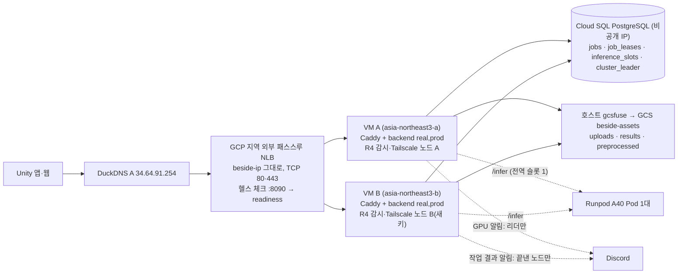

# D2 — API 계층 이중화를 코드로: active-active 설계안 (2026-11-25)

- **기준 코드**: 줄 번호는 main `d6e25d1` 기준입니다. VM 이 쓰는 `625c2a5` 와 backend·deploy 는 같습니다.
- **조사 방법**: 파일과 리소스는 하나도 바꾸지 않았습니다. GCP 는 `list`·`describe` 만, VM 은 읽기 명령만 썼습니다.
- **앞 조사의 줄 번호 정정**: `main` 에서 다시 보니 세 곳이 달랐습니다.
  - `DatabaseBackup` 의 `@Scheduled` 는 :48, `BACKUP TO` 는 :66 입니다(표에는 :104·:122).
  - `ShareService.create` 의 `synchronized` 는 :72 입니다.
- **표기**: [확인] 이번에 읽어서 확인, [구현됨]·[실험 결과]·[계획]은 CLAUDE.md 의 뜻, [가설] 확인하지 않음, [제안] 정해지지 않은 값.

## 1. 한 줄 요약과 막는 장애

**요약**: backend 두 대를 서로 다른 zone 에 두고 앞에 GCP 지역 패스스루 NLB 를 둡니다. 두 대는 같은 Cloud SQL(PostgreSQL)과 GCS(gcsfuse 마운트)를 함께 씁니다. 작업 배분은 DB 임대(lease)로 바꿉니다. 노드 하나가 죽으면 헬스 체크가 트래픽을 옮기고, 대기 작업은 남은 노드가 이어받습니다. GPU Pod 는 그대로 하나입니다.

| 막는 장애 | 지금 [실험 결과] | D2 뒤 [가설] |
|---|---|---|
| FD1 backend 강제 종료 | 외부 17.8 s 동안 502. 재시작하면 PENDING·PROCESSING 이 모두 INTERNAL_ERROR | 다른 노드가 응답. 대기 작업 유실 0, 그 노드의 PROCESSING 만 실패 |
| FD2 backend 멈춤 | R4 가 112 s 뒤 재시작 | 헬스 체크가 십수 초 안에 우회. 늦게 깨어난 노드의 쓰기는 펜싱으로 막힘 |
| FD3 VM 재시작 | 외부 82.8 s 끊김 | 남은 노드가 응답 |
| FD6 VM 통째 유실 | 145 s + 사람 손 | 자동 우회. DB 와 파일이 VM 밖에 있어 잃는 데이터 없음 |
| FD7 Caddy 종료 | 2.0 s | 노드마다 Caddy 가 있어 일부 요청만 |
| FD5 DB 파일 유실 | 지금은 시작 거부 | H2 파일이 없어지므로 이 형태로는 생기지 않음. Cloud SQL 백업·PITR 로 대체 |
| 배포 | `deploy_vm.sh` 가 곧 재시작이라 진행 중 작업 실패(제약 23) | 한 대씩 비우고 배포 |

**못 막는 장애**:
- GPU 쪽 전부(FD10~FD18). Pod 가 하나뿐입니다.
- 두 노드가 함께 갖는 원인: 잘못된 배포, `.env` 오류, FD17 토큰 불일치.
- FD4 디스크 가득 참은 일부만 막습니다. 결과 파일은 GCS 로 가지만 `tmp`·로그는 로컬이고, healthz 는 200 그대로입니다.
- DuckDNS·TLS(FD8).
- zonal Cloud SQL 이 있는 zone 의 장애. HA 가 있어야 막습니다.
- 리전 장애, "감지가 안 되는 장애"(FD13·FD15).

## 2. 구성 그림

### 2.1 DB 선택

| 안 | 장점 | 단점 | 판정 |
|---|---|---|---|
| 같은 VM 의 PG 컨테이너 | 0원 | VM 이 죽으면 DB 도 죽습니다. 8 GB VM 에 backend 3 GB(compose:68) 두 개와 PG 를 함께 못 넣습니다 | 데이터 옮기기 연습용만 |
| 별도 VM(e2-small)의 PG | 서울 $15.69/월 | DB VM 이 새 단일 장애점입니다. 백업·패치를 직접 해야 합니다 | 예산이 정말 없을 때 |
| **Cloud SQL Enterprise db-g1-small(zonal)** | 자동 백업·PITR. 비공개 IP 로 붙으면 컨테이너가 메타데이터 서버 없이 접속합니다(R1 결정 유지, block-metadata.sh:2-6). 나중에 HA 로 올릴 수 있습니다 | 약 $33/월 + 저장소. 공유 코어는 SLA 대상이 아닙니다. sqladmin·servicenetworking API 를 켜야 합니다(sqladmin 이 꺼져 있음을 [확인]) | **권장** |
| Cloud SQL HA | zone 장애에도 DB 가 남습니다 | 약 2배 | 훈련·시연 기간에만 [선택] |

### 2.2 파일: 호스트 gcsfuse, 코드 변경 0

- **코드를 바꾸지 않아도 되는 이유**: DB 에 저장된 경로가 모두 상대 경로이고 `/app` 기준입니다(application.properties:7, application-real.properties:35·47, JobServiceImpl.java:391·396, RealJobWorker.java:339). 그래서 두 노드가 같은 버킷을 `/app/storage/{uploads,results,preprocessed}` 에 마운트하면 `resolveAsset`(JobServiceImpl.java:295-306)이 그대로 맞습니다.
- **Java GCS 클라이언트를 쓰지 않는 이유**: 컨테이너의 메타데이터 접근을 막아 두었고(block-metadata.sh:16), 키 파일은 "키 없음" 결정(REDUNDANCY.md:65)에 어긋납니다.
- **gcsfuse 메타데이터 캐시 TTL 을 0 으로 해야 합니다**: 그렇지 않으면 다른 노드가 방금 만든 GLB 가 없는 것처럼 보여 `ASSET_NOT_FOUND` 가 납니다 [가설: 기본 TTL].
- **로컬에 남길 것**: `storage/tmp`, `events.jsonl`(노드별 파일 이름), 로그.
- **asset 은 지금처럼 backend 가 흘려 보냅니다**: 서명 URL 302 로 바꾸면 계약 변경입니다(openapi.yaml:202-217 은 200 + Content-Length).

### 2.3 작업 배분: DB 임대 (`jobs.dispatch=async|db`, 기본 async)

- **새 표**:
  - `job_leases(job_id, attempt, owner, lease_until)`: Job 엔티티와 따로 둡니다. Job 은 `save()` 가 행 전체를 merge 하므로(JobRepository.java:17, Job.java:19-20) 같은 표에 두면 오래된 사본 저장이 임대를 되돌립니다.
  - `inference_slots(slot_no, job_id, owner, lease_until)`
  - `cluster_leader(id, owner, lease_until)`
- **가져가기(claim)**:
  - 가장 오래된 PENDING 을 `(queuedAt, id)` 순으로 몇 건 읽고, 그중 하나에 조건부 쓰기를 합니다. 임대가 없으면 INSERT(PK 충돌이면 진 것), 만료됐으면 `UPDATE … WHERE job_id=? AND lease_until < now`.
  - H2 와 PG 에서 똑같이 돌고 시험하기 쉽습니다. PG 에서는 `FOR UPDATE SKIP LOCKED` 를 최적화로 더할 수 있습니다 [선택].
  - 본보기는 이미 있습니다: `startRetry` 의 조건부 UPDATE(JobRepository.java:62-68).
- **하트비트**: 10 s 마다 갱신하고, 임대는 45 s 입니다 [제안].
- **펜싱(오래된 쓰기 막기)**:
  - `start` 를 `WHERE status='PENDING' AND attempt=?` 로 바꿉니다. 지금은 JVM 안 잠금뿐입니다(JobTransitions.java:30-31, 54-66).
  - 끝내기는 `WHERE status='PROCESSING' AND attempt=? AND 내 임대`로 바꿉니다. 지금 JobFinisher 는 저장만 합니다(JobFinisher.java:49·70).
  - 진 쪽은 `job_runs`·이벤트·알림을 쓰지 않습니다.
- **만료 정리(LeaseReaper, 15 s, 모든 노드)**:
  - 만료된 PENDING 임대는 지웁니다. 작업은 줄로 돌아가고, 아직 GPU 에 가지 않았으므로 다른 노드가 그대로 이어받습니다.
  - 만료된 PROCESSING 은 FAILED(INTERNAL_ERROR)로 닫습니다. 지금과 같은 결과이고, 계약(CONTRACT.md:61)에 PROCESSING→PENDING 전이가 없어서 다시 돌리지 않습니다.
- **InterruptedJobRecovery**(InterruptedJobRecovery.java:33-38): db 모드에서는 이 호스트의 이전 실행이 남긴 임대만 바로 정리하고, 다른 노드의 작업은 건드리지 않습니다.
- **전역 GPU 슬롯**: 노드마다 있는 `InferenceSlots`(RealJobWorker.java:101·128)를 DB 행 임대로 바꿉니다.
  - 죽은 노드의 슬롯은 "임대 만료 **그리고** 추론 healthz 의 `busyForMs` 가 비었을 때"만 회수합니다.
  - 그래야 GPU 에서 아직 도는 고아 요청 뒤에서 다음 요청이 `MODEL_LOCK` 을 기다리다 시간 초과하는 일(제약 15, 운영 120 s: application-real.properties:17)을 피합니다.

### 2.4 예약 작업과 알림

- **리더 한 대만**: 60줄 정도의 직접 만든 `LeaderLease` 로 정합니다.
  - GPU 알림(WebhookNotifier.java:210-223)
  - 대기열 오래된 행 경고(AdmissionGate.java:257)
- **모든 노드가 그대로 돌릴 것**:
  - `InferenceHealthMonitor` 폴링(:180). 노드마다 자기 워커가 GPU 상태를 알아야 합니다.
  - `JobQueueGauge`(:43). DB 전체 값이라 대시보드는 `max()` 로 봅니다.
- **끌 것**: `DatabaseBackup`(:48, H2 전용)은 `STORAGE_BACKUP_ENABLED=false` 로 끕니다. Cloud SQL 백업이 대신합니다.
- **작업 결과 알림**은 끝내기 조건부 쓰기에서 이긴 노드만 보냅니다(JobFinisher.java:95). 그래서 한 번만 갑니다.
- **ShedLock 을 쓰지 않는 이유**: ShedLock 은 "한 번만 실행"용입니다. 여기서 필요한 것은 "모두 폴링하고, 보내기는 하나만"이라 맞지 않습니다. 한 번만 돌릴 작업이 늘면 [선택]으로 둡니다.

### 2.5 앞단 비교

| 안 | 전환 | 인증서 | DNS | 판정 |
|---|---|---|---|---|
| **지역 외부 패스스루 NLB(TCP) + 노드마다 Caddy** | 헬스 체크로 자동 | 지금 인증서를 `caddy_data` 째 복사합니다. 만료가 2027-02-10 이라 [확인] 종강까지 갱신이 없습니다 | `beside-ip` 가 지역 주소라 전달 규칙에 그대로 씁니다(create_vm.sh:36·70). DuckDNS 를 바꿀 필요가 없습니다 | **권장**. Caddyfile 과 공개 경로 61개를 그대로 씁니다 |
| 지역 외부 Application LB | 자동, L7 | Google 관리 인증서에는 CNAME 승인이 필요한데 DuckDNS 로는 안 됩니다 [가설]. 인증서를 직접 올리고 Caddy 를 평문 뒤로 돌려야 합니다 | 같음 | 바꿀 것이 많음 |
| Caddy 두 대 + DNS/IP 전환 | 사람이나 스크립트가 고정 IP 를 옮김(분 단위) | 복사 | A 레코드가 1개라 라운드 로빈이 안 됩니다 | L2 와 같고 자동 전환이 아님 |

**헬스 체크 구성**:
- Caddy 에 `:8090` 사이트를 하나 더 두고 `backend:8081/actuator/health/readiness` 로 보냅니다. 이 응답에는 DB 상태가 포함되고, graceful shutdown 때 먼저 빠집니다.
- 방화벽은 GCP 헬스 체크 대역에만 엽니다.
- 쿼터는 충분합니다 [확인]: `FORWARDING_RULES 0/15`, `CPUS_ALL_REGIONS 2/12`, `IN_USE_ADDRESSES 1/4`.

## 3. 목표 RTO·RPO [제안]

| 경우 | 지금 | 목표 | 근거 |
|---|---|---|---|
| 노드 하나의 프로세스·VM 장애 | 17.8~145 s 전체 중단 [실험 결과 FD1·FD3·FD6] | 일부 요청 실패 ≤ 15 s | 헬스 체크 5 s × 2회 + 여유 |
| 그 노드의 대기 작업 | 전부 INTERNAL_ERROR | 유실 0. 넘겨받기까지 ≤ 46 s | 임대 45 s + 폴링 1 s |
| 그 노드의 PROCESSING 작업 | INTERNAL_ERROR | ≤ 60 s 안에 INTERNAL_ERROR, 앱이 다시 시도 | 임대 45 s + 정리 15 s. 앱의 600 s 포기보다 짧음 |
| 배포 | 진행 중 작업 실패 | 실패 0 | readiness 로 빼기 → 비우기 → 재시작 |
| DB 데이터 | RPO ≤ 1 h(매시 백업) | 커밋된 것 0, 논리 오류는 PITR 로 분 단위 | Cloud SQL |
| 파일 | RPO 24 h(하루 1번 업로드) | 0 | GLB 저장(RealJobWorker.java:182)이 COMPLETED 커밋(:183)보다 먼저입니다. gcsfuse 가 파일을 닫을 때 올린다는 점은 [가설] |
| Cloud SQL zone 장애 | — | zonal 이면 수십 분(사람이 복구). HA 면 약 1분 [문서 일반값, 미확인] | |

## 4. 조각 목록

공통 규칙:
- 조각마다 시험을 먼저 쓰고, `.\gradlew.bat test` 로 `JobV1ContractTest` 까지 통과시킵니다.
- 기본값 `jobs.dispatch=async` 가 지금 동작을 그대로 지킵니다. mock 도 async 그대로입니다.

| # | 할 일 | 바꿀 파일 / 자원 | 시험·확인 | 시간 [가설] | 사람이 할 것 |
|---|---|---|---|---|---|
| D2-1 | 조건부 상태 전이와 끝내기 펜싱(제약 6) | `repository/JobRepository.java`, `service/JobTransitions.java`, `service/JobFinisher.java`, 새 시험 `service/JobTransitionsCrossNodeRaceTest.java` | 잠금을 나누지 않는 `JobTransitions` 두 개로 start↔cancel 500번 경합 → 매번 한쪽만 이기고, CANCELED 뒤 PROCESSING 0건. 기존 RaceTest·CancelTest 통과 | 1일 | 없음. H2 단일 노드에도 배포 가능 |
| D2-2 | 임대 표와 노드 ID | 새 `domain/JobLease.java`, `repository/JobLeaseRepository.java`, `config/NodeIdentity.java`, 시험 `JobLeaseRepositoryTest.java` | 2 스레드 × 200건 claim → 작업마다 한 번. 만료된 것만 넘어감. 남의 임대 갱신은 0행 | 1일 | 없음 |
| D2-3 | 전역 GPU 슬롯(제약 5·15) | 새 `domain/InferenceSlotLease.java`, `service/GlobalInferenceSlots.java`, `service/InferenceSlots.java`(인터페이스로 뽑기), 시험 `GlobalInferenceSlotsTest.java` | 인스턴스 둘·DB 하나에서 동시 보유가 1을 넘지 않음. `busyForMs` 가 있으면 회수하지 않음 | 1일 | 브랜치 `fix/review-2026-11-25` 의 미커밋 InferenceSlots·RealJobWorker 변경이 병합된 뒤 시작(충돌) |
| D2-4 | DB 배분기(플래그) | 새 `service/DbJobDispatcher.java`, `service/RealJobWorker.java`(:116-136 본문을 `runClaimed` 로), `service/JobServiceImpl.java`(:190·:223·:419-428), `application.properties`(`jobs.dispatch`, `jobs.lease-ms`, `jobs.heartbeat-ms`, `spring.flyway.enabled=false`) | `RealJobQueueTest` 를 db 모드로 한 번 더 → 순서·취소·오프라인 대기가 같음. 새 `DbJobDispatcherTest`: queuedAt 순서로 claim | 2일 | 없음 |
| D2-5 | 만료 정리로 InterruptedJobRecovery 대체(제약 4·23) | 새 `service/LeaseReaper.java`, `service/InterruptedJobRecovery.java`, 새 `TwoNodeTakeoverTest.java`(`SpringApplicationBuilder` 컨텍스트 2개 + 공유 `jdbc:h2:mem` + 가짜 추론 HttpServer — Docker 없는 이 PC 에서도 돎), `docs/api/ERROR_CODES.md:75` 문구 | A 의 하트비트 멈춤 → A 가 가져간 PENDING 은 B 가 끝냄, A 의 PROCESSING 은 ≤ 60 s 에 INTERNAL_ERROR 1번·이벤트 1번. A 재시작이 B 의 작업을 건드리지 않음. 늦은 A 의 COMPLETED 는 0행 | 1.5일 | 문구 변경을 PR 과 CHANGELOG 에 한 줄 |
| D2-6 | 리더와 알림 중복 제거(제약 10·11) | 새 `service/LeaderLease.java`, `service/WebhookNotifier.java`, `service/AdmissionGate.java`, 시험 `InferenceAlertTwoNodeTest.java` | 두 노드·웹훅 수집기 하나 → GPU DOWN 한 번에 메시지 1개. 리더가 죽으면 30 s 안에 다른 노드가 이어받음 | 1일 | 없음 |
| D2-7 | PostgreSQL·스키마 이전 도구·데이터 옮기기(제약 1·9) | `backend/build.gradle.kts`(postgresql, flyway-core, testcontainers), 새 `db/migration/V1__baseline.sql`, 새 `tool/H2ToPostgres.java`, 시험 `PostgresSchemaTest`·`H2ToPostgresTest` | `@Testcontainers(disabledWithoutDocker=true)`: 로컬은 건너뛰고 CI ubuntu 에서 돎(backend-ci.yml:25·40). `ddl-auto=validate` 통과, 표 7개 행 수 같음 | 2.5일 | sqladmin·servicenetworking API 켜기, Cloud SQL 만들기 승인(과금), DB 비밀번호를 만들어 VM `.env` 에 넣기 |
| D2-8 | 파일 공유(gcsfuse)와 노드별 설정(제약 2·12) | 새 `deploy/gcp/assets_bucket.sh`, 새 `deploy/gcsfuse/`(마운트 유닛, 캐시 TTL 0), 새 `deploy/docker-compose.ha.yml`, `deploy/backup/offsite_backup.sh`(H2 zip 없는 노드는 DB 부분 끄기 — 브랜치의 877f63b 신선도 검사가 PG 노드에서는 늘 실패), `scripts/test_offsite_backup.sh` | VM A 가 쓴 GLB 를 VM B 가 1 s 안에 asset 200. 기존 54 MB 를 rsync 한 뒤 COMPLETED 작업 전부 asset 200 | 1.5일 | gcsfuse 설치(Google 저장소) 승인, 버킷·IAM 승인(VM 서비스 계정에 이 버킷만 objectUser) |
| D2-9 | VM B, NLB, 감시(제약 16·17·18·21) | `deploy/gcp/create_vm.sh`(고정 IP 없이), 새 `deploy/gcp/create_lb.sh`, `deploy/Caddyfile`(`:8090`), `application-prod.properties`(probes·graceful shutdown), `deploy/monitoring/prometheus.yml`(대상 2개) | `scripts/test_gcp_ops.sh`(가짜 gcloud, CI 에 이미 있음)에 경우 추가. `deploy/test_caddy_routes.sh` 61개를 LB 와 노드마다 | 2일 | 점검 창 공지, 고정 IP 를 옮기는 동안 수 분 중단 승인, VM B 의 Tailscale 새 인증 키(스냅샷 복제 금지) |
| D2-10 | 넘기기·훈련·기록 | A 정지 → 마지막 H2 백업 → H2ToPostgres → 파일 rsync → A·B 를 db 모드로 → IP 를 NLB 로 → 61/61 → 6절 훈련 → `docs/ops/…_aa-drills.md` | 6절의 측정표 | 1.5일 | 창 승인, Pod 켜기(실제 GPU 1~2 h) |

**합계**: 1명 기준 약 15일 [가설]. 두 명이 코드(D2-1~6)와 인프라(D2-7~9)를 나누면 달력으로 8~9일입니다.

### 4.1 계약(openapi) 영향 확인

**openapi.yaml 변경 없음**: 경로, 필드, 상태 코드, enum 이 모두 그대로입니다.

지켜야 할 것:
1. **새 Spring 프로파일을 만들지 않습니다.** healthz 의 `profile` 은 활성 프로파일을 그대로 냅니다(JobV1Controller.java:197-199). openapi.yaml:1395 와 RUNBOOK.md:19 는 공개 서버가 `real,prod` 를 낸다고 적고 있습니다. 그래서 PG 설정은 환경 변수로 넣습니다(`SPRING_DATASOURCE_*`, `SPRING_JPA_HIBERNATE_DDL_AUTO=validate`, `SPRING_FLYWAY_ENABLED=true`).
2. **asset 은 계속 200 스트림으로 줍니다.** 302 로 바꾸지 않습니다.
3. **`queue.ahead` 와 `estimate` 는 그대로입니다.** 이미 DB 로 계산하고, "GPU 1장 기준"이라는 설명도 맞습니다. 슬롯은 전역 1입니다.

**설명 문구만 바뀌는 곳**:
- `ERROR_CODES.md:75` 는 "재시작 때 PENDING/PROCESSING 이던 작업" 이 INTERNAL_ERROR 가 된다고 적고 있습니다. db 모드에서는 PENDING 이 살아남으므로 이 문구를 고칩니다.
- 코드값과 상태 코드는 바뀌지 않아 계약 회의는 필요 없고, PR 과 CHANGELOG 에 한 줄 남깁니다.
- `CONTRACT.md:83` 은 mock 절이고, mock 은 async 그대로입니다.

**대기열 상한**: 운영에서는 꺼져 있습니다(application.properties:99). 두 대에서 켜면 동시에 들어오는 요청만큼 상한을 넘을 수 있습니다(제약 7). 켜기 전에 이 점을 문서에 적거나 DB 예약으로 바꿉니다.

## 5. 비용

가격 출처는 표 아래에 있습니다.

| 항목 | 월 | 출처 |
|---|---|---|
| 지금: VM e2-standard-2 | $62.75 | 서울 $0.086/h, gcloud-compute.com(2026-11-22 갱신, 제3자) |
| 지금: 디스크 50 GB + 고정 IP + 스냅샷 약 13.7 GB(일정 5개 + 훈련 스냅샷 7.0 GB, 아직 남아 있음 [확인]) | 약 $10 | 서울값 미확인 [추정] |
| 추가: VM B(+ 디스크 + 임시 IP) | 약 $72 | 위와 같음 |
| 추가: VM A 의 송신용 임시 IP | 약 $3.65 | $0.005/h [미확인] |
| 추가: NLB 전달 규칙(5개까지) | 약 $18.25 | $0.025/h, cloud.google.com/load-balancing/pricing(검색 요약, 서울값 미확인) |
| 추가: Cloud SQL db-g1-small + 10 GB | 약 $36 | 서울 약 $33/월, bytebase.com dbcost(날짜 미표기, 제3자). db-f1-micro 는 약 $10 |
| 추가: GCS 에셋 약 54 MB | $0.01 미만 | $0.023/GB, REDUNDANCY.md:38 |

**합계**:
- 지금 약 $73/월(약 $2.4/일).
- D2 를 다 하면 약 $205/월(약 $6.8/일).
- Cloud SQL 을 HA 로 하면 약 $240/월.

**크레딧** [추정, 콘솔 '결제 → 크레딧'은 미확인]:
- VM 은 11-12 부터 돌았으므로 지금까지 약 $30~35 를 썼고, 약 $265 가 남은 것으로 봅니다.
- 12/04 까지는 지금 구성만 쓰면 +$22 입니다.
- 12/21 까지:
  - 지금 구성만: +$63 → 약 $200 남음
  - 12/05 부터 D2 전체(17일): +$75 더 → 약 $125 남음
  - **1~2일 시연 창**(세우고 → 훈련하고 → 철거): +$5~10
- 어느 경우든 무료 크레딧 안입니다.

**Runpod**: 훈련용 A40 1~2 h 로 약 $1.2 입니다($0.59/h, REDUNDANCY.md:48). 잔액(약 $200)은 이번에 조회하지 않았습니다.

## 6. 발표에서 보여 줄 증거

**순서**: AA-0 → AA-7. 외부 탐침은 `scripts/fault/drill_client.py`(1초 healthz + 주기적인 작업 흐름)를 씁니다. 주입은 `vm_drill.sh` 에 노드 인자를 더해 씁니다.

| ID | 주입 | 잴 것 |
|---|---|---|
| AA-0 | 정상 상태, 낮은 부하 | 노드별 요청 비율(Prometheus `instance`), p95 |
| AA-1 | B backend `kill -9`(FD1 재현) | 외부 non-2xx 초, 넘겨받은 PENDING 수, PROCESSING→INTERNAL_ERROR 까지 시간 |
| AA-2 | A SIGSTOP 180 s(FD2) | LB 가 빼기까지 시간, 깨어난 A 의 쓰기 0행(펜싱), R4 재시작 |
| AA-3 | A VM stop(FD3·FD6 대신) | 외부 끊김, 다시 붙기까지 |
| AA-4 | 작업이 흐르는 중 순차 배포 | 실패 작업 0 |
| AA-5 | B 가 처리 중일 때 A 재시작 | B 작업 영향 0(제약 4 회귀 시험) |
| AA-6 | Pod 서비스 정지 | GPU 상태 알림이 전이마다 1개(중복 0) |
| AA-7 | (HA 일 때만) `gcloud sql instances failover` | API 오류 창 |

- **표 열**: 지금 [실험 결과 FD×] | D2 [실험 결과 AA×] | 잃은 작업 | 중복 알림.
- **12/04 에 보여 줄 수 있는 것**: D2-1(~5)의 두 노드 시뮬레이션 시험 결과 [구현됨]과 이 설계 [계획] 뿐입니다. 운영 측정값은 없습니다.

## 7. 위험, 되돌리기, 하지 않을 것

**위험**:
- 발표 직전에 운영 DB·파일을 옮기고 IP 를 바꾸는 것.
- gcsfuse 캐시 때문에 다른 노드의 파일이 404 로 보이는 것.
- 공유 코어 Cloud SQL 의 연결 수 한도: Hikari 를 노드당 8 이하로.
- Flyway 가 H2 에서 켜지는 것: 기본값을 꺼 둬야 합니다.
- 고아 GPU 요청과 슬롯 회수(2.3절).
- VM 서비스 계정 권한이 늘어남: 버킷 하나에 objectUser. 컨테이너는 계속 차단합니다.
- 한 사람이 다른 마감과 겹치는 것.

**되돌리기**:
- 코드는 `jobs.dispatch=async` 와 H2 URL 로 돌아가면 됩니다.
- 앞단은 전달 규칙을 지우고 `beside-ip` 를 VM A 에 다시 붙입니다(수 분).
- 넘기기 전 H2 zip 과 스냅샷이 남아 있습니다.
- 다만 **넘긴 뒤 PG 에 생긴 작업은 H2 로 돌아가지 않습니다.** 역방향 도구는 만들지 않습니다.

**하지 않을 것**:
- PROCESSING 작업 자동 재실행: 계약에 없는 전이입니다.
- 서명 URL 리다이렉트: 계약 변경입니다.
- Filestore: 최소 용량이 큽니다.
- Pub/Sub·Redis 큐: 이 규모에서는 DB 로 충분합니다.
- 멀티 리전, MIG 자동 확장, Cloud Function 자동 전환.
- 대기열 상한을 켠 채 두 대 운영.
- 다중 GPU 풀 G2.

## 8. 어디까지 가능한가

- **12/04 전(9일, 발표·보고서·Unity 빌드와 겹침)**:
  - D2-1 만 [구현됨] 목표(1일)로 잡고, 여유가 있으면 D2-2 까지 합니다.
  - **운영 배포는 하지 않습니다.**
  - 발표의 이중화 증거는 L1 진짜 전환 연습(코드 0, 반나절~1일)과 이 설계 [계획] 으로 합니다.
- **12/05~12/21**:
  - 코드 D2-2~6(약 6.5일)은 현실적입니다. 두 노드 시험이 [구현됨] 증거가 됩니다.
  - 인프라 D2-7~10(약 7.5일)은 1명이면 빠듯합니다.
  - 권장은 스크립트를 미리 CI 에서 시험해 두고 **1~2일 시연 창**에서 AA-0~6 을 잰 뒤 철거하는 것입니다(약 $5~10).
- **그 뒤(프로젝트가 계속되면)**: Cloud SQL HA, PG `SKIP LOCKED`, 대기열 상한 DB 예약, G1·G2 GPU 풀, MIG 자동 복구, 자동 전환.

**핵심 파일**(main `d6e25d1` 기준, `git show d6e25d1:<경로>` 로 읽음):
- `backend\src\main\java\com\example\mockbackend\service\{InterruptedJobRecovery,JobTransitions,JobFinisher,RealJobWorker,InferenceSlots,JobServiceImpl,WebhookNotifier,AdmissionGate}.java`
- `backend\src\main\java\com\example\mockbackend\repository\JobRepository.java`
- `deploy\docker-compose.yml`, `deploy\Caddyfile`
- `docs\api\openapi.yaml`, `docs\api\ERROR_CODES.md`, `docs\CONTRACT.md`
- `docs\ops\REDUNDANCY.md`

**가격 출처**(2026-11-25 조회):
- [gcloud-compute.com e2-standard-2](https://gcloud-compute.com/e2-standard-2.html)
- [gcloud-compute.com e2-small](https://gcloud-compute.com/e2-small.html)
- [Bytebase db-g1-small](https://www.bytebase.com/dbcost/cloudsql/instance/db-g1-small.md)
- [Bytebase db-f1-micro](https://www.bytebase.com/dbcost/cloudsql/instance/db-f1-micro.md)
- [Cloud Load Balancing pricing](https://cloud.google.com/load-balancing/pricing)
- [LB SKU 안내](https://docs.cloud.google.com/load-balancing/docs/sku-announce?hl=en)

GCP 공식 가격표는 페이지가 그려지지 않아 직접 읽지 못했습니다. 서울 공식값은 미확인입니다.