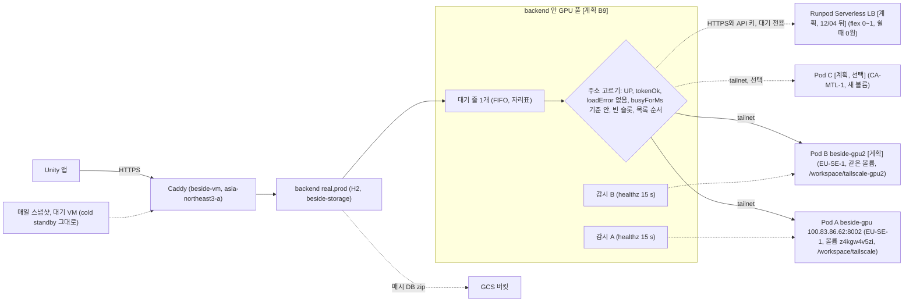

# 설계안 D3: GPU 계층부터 이중화하기 (GPU 풀과 시연 시간 두 대 운용)

**기준.** main `d6e25d1`, VM `625c2a5`, 2026-11-25에 읽기로만 조사했습니다. 파일은 만들거나 고치지 않았고, VM·Runpod·GCP에는 읽기 호출만 했습니다.

## 0. 이번에 확인한 사실

| 확인한 것 | 결과 | 근거 |
|---|---|---|
| Runpod Pod | 8개 모두 EXITED입니다. 모두 A40, EU-SE-1에 있고, 볼륨 `z4kgw4v5zi`를 `/workspace`에 붙입니다. 이 중 `beside-gpu7`·`beside-gpu5`·`beside-gpu2` 셋은 켜질 때 main을 받아 `/workspace/beside-bootstrap.sh`를 실행하는 시작 명령이 들어 있습니다 | `list-pods` |
| 네트워크 볼륨 | `z4kgw4v5zi` `beside-workspace` 하나뿐입니다. 30 GB, EU-SE-1, STANDARD | `list-network-volumes` |
| Runpod 잔액 | **$181.52** (선불) | `get-balance` |
| 최근 10일 Pod 지출 | **$17.93**: GPU $14.60, CPU $3.22, 디스크 $0.11. Pod 15개 분이고, 정지한 날은 청구가 없습니다 | `list-pod-billing` (day, lastN 10) |
| A40 가격 | Pod Secure **$0.59/h**, Community $0.35/h, Serverless **$1.22/h** | `get-gpu-type NVIDIA A40` |
| A40 Pod 재고 | 배치 조건(GPU당 vCPU 4·RAM 24 GB)으로 EU-SE-1 **LOW**, CA-MTL-1 **LOW** | 같은 조회, product POD |
| A40 Serverless 재고 | EU-SE-1 **HIGH**, CA-MTL-1 **HIGH** | 같은 조회, product SERVERLESS |
| 다른 48 GB GPU | RTX A6000: 전체 NONE, 표에는 EU-SE-1만 LOW로 나오지만 CUDA 버전이 모두 '없음'이라 사실상 없습니다. L40S: EU-NL-1·EUR-IS-2·OC-AU-1에만 있어 우리 볼륨에 붙일 수 없습니다 | `get-gpu-type` |
| 네트워크 볼륨 규칙 | 같은 데이터센터의 Pod 여러 대가 동시에 붙일 수 있습니다. 다만 동시에 쓰면 데이터가 깨질 수 있습니다. 다른 데이터센터에서는 붙일 수 없고 동기화도 없습니다. Serverless에서는 `/runpod-volume`으로 보입니다 | `lookup-concept network volume` (docs.runpod.io/storage/network-volumes) |
| Serverless 부하 분산(LB) 엔드포인트 | 대기 줄이 없어 일꾼이 모두 바쁘면 요청을 버립니다. 일꾼이 없으면 2분 뒤 오류입니다. 처리 상한 5.5분, 본문 상한 30 MB입니다. `/ping`이 200이면 준비, 204면 아직 로딩입니다. 요청이 3일 없으면 최대 일꾼 수가 2로, 7일 없으면 0으로 줄어듭니다 | `search-docs` (Runpod 블로그 serverless-gpu-inference, docs serverless/pricing) |
| Serverless 비용·콜드 스타트 | flex 일꾼은 켜진 순간부터 완전히 꺼질 때까지 초 단위로 청구됩니다. 기본 idle timeout은 5 s입니다. FlashBoot가 있으면 콜드 스타트 중앙값이 약 1.5 s이지만, 15번 중 2번은 완전 부팅으로 약 4분이 걸렸습니다 | 같은 출처 |
| VM 설정 | `deploy/.env`에 `INFERENCE_BASE_URL` 키가 1개 있습니다(값은 출력하지 않음). tailnet의 GPU 노드는 `beside-gpu 100.83.86.62` 하나입니다. VM은 2 vCPU, 메모리 7,934 MB입니다 | ssh 읽기 명령 |
| GCP 외부 가동 감시 비용 | 실행 100만 회까지 무료입니다. 1분 간격, 3개 지역이면 한 달 약 131,400회라 무료입니다 | cloud.google.com/stackdriver/observability-pricing-examples (2026-11-25 조회) |
| 다른 세션의 커밋 | `fix/review-2026-11-25`의 `7a8a56c`가 `InferenceSlots`(자리를 미리 잡는 `acquire(ticket, …)`)와 `RealJobWorker`를 바꿨습니다. 이 안이 고칠 파일과 같습니다 | `git log`, `git show 7a8a56c --stat` |

## 1. 한 줄 요약과 막는 장애

**요약 [계획]**: backend가 추론 주소를 여러 개 받아, 주소마다 건강 상태(`/healthz`의 `instanceId`·`tokenOk`·`loadError`·`busyForMs`)와 슬롯을 따로 두고 골라 씁니다(B9). 발표·시연 시간에만 **EU-SE-1의 같은 볼륨에 A40 Pod 두 대**를 켜 두어, 한 대가 빠지면 줄에 있는 작업을 다른 한 대가 곧바로 처리하게 합니다. API·VM 계층은 지금의 cold standby를 유지하고 R3와 대기 VM 첫 시작 절차만 보탭니다.

**막는 장애.** 두 대 중 한 대에서만 일어날 때 해당합니다. 아래 동작은 모두 [계획]이고, 1대 기준 값은 [실험 결과]입니다.

| FD | 장애 | 풀에서의 동작 |
|---|---|---|
| FD16a | 멈춘 Pod가 같은 호스트의 GPU를 못 받음 | 새 Pod를 만드는 98 s 동안에도 B가 처리합니다. 복구가 사용자 경로에서 빠집니다 |
| FD16b | 부하 중 Pod 정지 | 대기 작업은 B로 갑니다. 진행 중이던 1건만 실패합니다(지금은 5차에서 52 s 뒤 실패) |
| FD12, F2-real, R7 | 추론 서비스 죽음 | R7이 A를 다시 띄우는 41 s 동안 B가 처리합니다 |
| FD14 | uvicorn 멈춤 | 2 s 뒤 A가 DOWN이 되고 B가 받습니다 |
| FD17 | 한 Pod만 토큰이 틀림 | `tokenOk=false`인 주소를 고르지 않습니다 |
| FD18 | 한 Pod만 모델 로드 실패 | `loadError`가 있는 주소를 고르지 않습니다 |
| FD13 | 한 Pod만 추론이 멈춤 | `busyForMs`가 120 s를 넘은 주소를 뺍니다. 그 안의 1건은 120 s 시간 초과로 끝납니다 |
| FD10 | 한 Pod의 tailnet만 끊김 | 14 s 뒤 DOWN이 되고 B가 받습니다 |

**못 막는 장애**:
- **API·VM 계층(FD1~FD9)**: 지금 장치(R4, 백업, 스냅샷)가 그대로 맡습니다.
- **VM 쪽 토큰이 틀린 FD17**: 두 Pod 모두 실패합니다.
- **FD11(느린 경로)**: UP으로 보여 걸러지지 않습니다.
- **FD15(GPU 메모리 부족)**: 건강 신호가 없습니다. 주소를 잠시 빼는 회로 차단기는 나중 단계입니다.
- **EU-SE-1 데이터센터 전체 재고 없음**: CA-MTL-1 Pod(P10)나 Serverless(나중)가 있어야 막습니다.
- **Tailscale 제어 평면 장애, Runpod 잔액 0**: 두 대가 함께 멈춥니다.
- **두 Pod가 같은 호스트에 놓이는 경우**: Runpod에서 호스트를 고를 수 없습니다 [가설, 확인 안 함].

## 2. 구성 그림

## 3. 목표 RTO·RPO [제안값]

| 상황 | 지금, GPU 1대 [실험 결과] | 풀 목표 [제안값] | 근거 |
|---|---|---|---|
| Pod 하나가 빠진 뒤 새 작업이 GPU를 다시 얻기까지 | 새 Pod 98 s(FD16a). 같은 Pod 재시작은 약 3분(FD16b 1차). F2-real은 kill에서 첫 완료까지 160.6 s | **20 s 이하** | 작업마다 고른 주소의 healthz를 새로 확인합니다(2 s 제한, RealJobWorker.java:264). 15 s 주기 확인이 DOWN을 기록하면 그 주소를 건너뜁니다 |
| 진행 중 작업 | 5차 FD16b: 52 s 뒤 `INFERENCE_UNAVAILABLE`(`instanceId`). 그 밖에는 내려받기 60 s(application-real.properties:23), POST 120 s(:17)까지 기다림 | **60 s 이하에 실패로 끝내기. 빠진 Pod 하나당 1건** | 다른 주소가 UP일 때만 "DOWN이 45 s 이어지면 포기"를 더합니다. 45 s는 prod `notify.down-grace-ms`와 같습니다(application-prod.properties:46). 앱이 retry하면 B로 갑니다 |
| 대기 작업 손실 | 0. 오프라인 대기 30분이 버팀(application-prod.properties:40) | **0** | 줄은 하나이고, 슬롯은 UP인 주소에서 나옵니다 |
| 대기 작업 최대 대기 | 5차 FD16b 74.3 s(5건). F2-real 175 s | **180 s 이하(W)**. 남은 용량의 0.7 이하 부하일 때 | 큐 상한 결정과 같은 W(queue-cap.md:32-34) |
| 데이터 RPO, GPU 계층 | 상태 없음. 모델은 볼륨에 있음 | 0 | 바꾸지 않습니다 |
| 두 대 모두 빠짐 | 지금과 같음(새 Pod 98 s, 30분 대기) | 지금과 같음 | — |
| API·VM | VM 재시작 82.8 s(FD3). 다시 세우기 145 s와 전환(FD6). DB 최악 약 75분, 파일 24 h | 그대로 | 이 안의 범위 밖. R3만 보탭니다 |

**진행 중 작업을 다루는 규칙** [계획]:
1. 줄에서 기다리는 작업은 아무것도 하지 않아도 B의 슬롯으로 갑니다.
2. A에 보낸 요청에는 두 가지 감시를 둡니다.
   - A의 `instanceId`가 바뀌면 바로 포기합니다. 지금 `restartWatch`(RealJobWorker.java:292-301)를 주소마다 둡니다.
   - A가 45 s 넘게 DOWN이고 다른 주소가 UP이면 포기합니다.
   - 다른 주소가 없으면 지금처럼 기다립니다. FD10에서는 tailnet이 120 s 끊겨도 TCP 재전송으로 작업이 살아났기 때문입니다.
3. 정리 `DELETE /artifacts`와 GLB 받기는 그 시도를 돌린 주소로만 보냅니다(InferenceClient.java:243-283, 338-347). A가 사라져 정리 요청이 실패하면 남은 폴더는 Pod의 오래된 폴더 정리에 맡깁니다.
4. 같은 시도 안에서 B로 다시 보내는 투명한 넘김은 12/04 뒤로 미룹니다. 상태와 자리 순서가 복잡해지기 때문입니다.

**큐 상한 N 규칙** [계산]. 운영에서는 지금 꺼져 있으므로 적용은 [계획]입니다.
- 식은 queue-cap.md:33을 따릅니다: N = ⌊μ·(W − T)/3600⌋, R = N·3600/μ.
- 5차 c=1 값은 S_busy 8.81 s, μ₁ = 409건/h입니다.
- Pod가 1대 UP일 때 N = 19, R = 167 s입니다.
- Pod 두 대의 처리량을 선형으로 더하면 μ₂ = 818건/h라고 놓을 수 있습니다 [가설]. 그러면 N = 38, R = 167 s입니다. **R은 GPU 수와 거의 상관없이 165~167 s**이고, **N은 UP인 대수에 비례**합니다.
- 받은 38건이 남았을 때 한 대가 빠지면 최악 대기는 약 38 × 8.81 + 8.81 ≈ 344 s입니다. 앱의 600 s 안입니다.
- 규칙: N_eff = 19 × max(1, UP 대수). μ₂는 6차 부하 시험에서 잰 값으로 바꿉니다. 같은 A40 안의 슬롯 2개는 1.19배 이상이었으므로 두 배로 놓으면 안 됩니다(queue-cap.md:64). 다른 Pod 두 대는 따로 재야 합니다.
- VM CPU 여유 [계산]: 작업당 3.68 core·s(vm-4th 8절)이므로 818건/h면 약 0.84 core, 2 vCPU의 약 42 %입니다. 70 % 상한은 약 1,370건/h입니다.

## 4. 조각 목록

| # | 할 일 | 바꿀 파일 또는 자원 | 테스트·확인 | 시간 [가설] | 사람이 할 일 |
|---|---|---|---|---|---|
| P0 | 선행: `fix/review-2026-11-25` 병합을 기다림. `7a8a56c`가 같은 파일을 고쳤습니다 | 없음 | main에 들어간 뒤 그 위에서 시작 | 0 | 그 PR 병합 |
| P1 | 설계·결정 문서 | `docs/ops/GPU_POOL.md`(새), `docs/ops/REDUNDANCY.md` 3절 GPU 행·4절 순서, `docs/METRICS.md`(지표에 `gpu` 태그 추가 기록, 계약 '추가' 규칙) | 문서 검토. 공개 API v1은 바꾸지 않습니다. 관리 화면 `inference`는 대표값만 유지합니다 | 0.5일 | 검토 |
| P2 | backend GPU 풀 | 아래 '바꿀 곳' 참고 | 아래 '시험' 참고 | 2~4일, 500~900줄 | PR 검토·병합 |
| P3 | 같은 볼륨에서 Pod 두 대가 돌 수 있게 | `deploy/runpod/start_pod.sh:49,53`(`TS_DIR`·`LOG_DIR`를 바꿀 수 있게. `WORK_DIR`·`NORESTART_FILE`·`TS_HOSTNAME`은 이미 바꿀 수 있음 :46,59,280,288). 볼륨에만 있는 `beside-bootstrap.sh`를 `deploy/runpod/`로 옮김(내용 미확인). `deploy/runpod/test_start_pod_supervisor.sh`에 경우 추가 | WSL에서 시험 스크립트 실행. 두 상태 폴더가 서로 다른 노드 키를 쓰는지 확인(제약 18) | 0.5일 | 없음 |
| P4 | Pod B 만들기 | Runpod: A40, EU-SE-1, 볼륨 `z4kgw4v5zi`, Secure, vCPU 4·RAM 24 GB 조건, Secret 토큰, `beside-gpu7`과 같은 시작 명령. 환경 변수 `TS_HOSTNAME=beside-gpu2` `TS_DIR=/workspace/tailscale-gpu2` `LOG_DIR=/workspace/beside-logs-gpu2` `WORK_DIR=/workspace/beside-work-gpu2` `NORESTART_FILE=/workspace/beside-norestart-gpu2` | VM에서 두 주소의 healthz(`instanceId`가 다르고 `modelLoaded` true). G0를 주소마다 10분 | 1~2시간 | 비용 승인($0.59/h). **Tailscale 로그인 링크 승인**(start_pod.sh:192에는 auth key가 없음). 새 100.x 주소 알려 주기. 끝나면 정지 |
| P5 | VM 배포 | `scripts/deploy_vm.sh`, VM `deploy/.env`에 `INFERENCE_BASE_URLS` | 공개 경로 61/61. 로그에 주소별 `UP` 두 줄 | 1시간 | 배포 창 공지(재시작하면 진행 중 작업이 실패, 제약 23) |
| P6 | 6차 부하 시험(풀) | `scripts/load`(`gpu_queue.js SLOTS=2` 사용), `docs/perf/load/2026-12-0x_vm-6th.md` | G0를 주소마다 → G3 풀 과부하(약 980건/h, 20~40분) → μ₂, 주소별 S·GLB 구간, VM CPU | 3시간 | 공지, Pod 두 대·k6 Pod 비용 승인 |
| P7 | 풀 장애 훈련 | `docs/ops/2026-12-0x_gpu-pool-drills.md`, `scripts/fault/vm_drill.sh`(Pod IP 하나만 막는 경우 추가) | 6절 순서대로 | 3시간(P6와 같은 창) | 같음 |
| P8 | N·R 다시 계산 | `scripts/load/cap_model.py` 출력을 `docs/perf/load/2026-11-20_queue-cap.md` 부록에 | 잰 μ₂로 N·R 계산 | 1시간 | 운영 적용은 Unity 새 빌드 뒤 [계획] |
| P9 | API 최소 보강 | R3: `deploy/gcp/uptime_check.sh create <channel>`. `docs/ops/RUNBOOK.md` 'VM 다시 세우기'에 대기 VM 첫 시작 절차 | `gcloud monitoring uptime list-configs`가 1개. 절차는 문서 검토 | 1시간 | **콘솔에서 메일 알림 채널 만들기**(5분) |
| P10 | (선택) Pod C, CA-MTL-1 | Runpod 볼륨 30 GB(CA-MTL-1) + Pod. `deploy/runpod/install_animallift.sh`(2026-11-17에 497 s), `/workspace/beside-rig` 템플릿 복사, `beside-gpu3` | G0로 서울↔몬트리올 경로의 S 재기(미측정) | 반나절 | 볼륨·Pod 생성 승인, Tailscale 승인. 나중에 볼륨 삭제 확인(되돌릴 수 없음) |

**P2에서 바꿀 곳**:
- `application-real.properties`: `inference.base-urls`(빈 값이면 `base-url` 하나), `inference.failover-after-ms=45000`, `notify.inference-labels`를 더합니다.
- `service/InferenceTarget.java`(새 파일): 주소, `InferenceClient`, `InferenceHealthMonitor`, 이름, 슬롯을 묶습니다.
- `InferenceSlots.java`: `free`를 주소별로 둡니다. 줄 맨 앞의 자리가 고를 수 있는 주소를 받습니다.
- `RealJobWorker.java:128-204, 254-301`: 고른 주소로 `infer`, `cleanup`, `restartWatch`, `failedRunDetails`를 하고, 진행 중 DOWN 감시를 더합니다.
- `InferenceHealthMonitor.java:149-180`: 주소마다 하나씩 두고, 주기 확인은 풀이 돌립니다.
- `WebhookNotifier.java`: 알림에 주소 이름을 붙이고, '모든 GPU 없음'을 따로 보냅니다.
- `QueueEstimator.java:83`: UP인 주소가 하나라도 있으면 offline이 아닙니다. 예상 시간을 대수로 나누는 것은 나중입니다(:42).
- `AdmissionGate.java:117,137-146`: 슬롯 수를 전체 슬롯으로 바꿉니다.
- `deploy/docker-compose.yml:27`에 `INFERENCE_BASEURLS: ${INFERENCE_BASE_URLS:-}`를 더하고 `deploy/.env.example`도 고칩니다.

**P2 시험**:
- 기존 시험 클래스 19개가 그대로 통과해야 합니다. 주소가 하나면 지금과 같아야 하기 때문입니다.
- `InferenceSlotsTest`: 주소 두 개, 한 주소 DOWN, FIFO 순서.
- 새 `InferencePoolTest`.
- `RealJobWorker*Test`에 스텁 서버 두 개를 두고 확인합니다:
  - A가 끊기면 B로 감.
  - A의 `instanceId`가 바뀌면 A로 보낸 요청만 포기함.
  - DELETE는 A로 감.
- `WebhookNotifierTest`.
- `.\gradlew.bat test`.

## 5. 비용

가격은 0절의 조회값입니다: A40 Pod $0.59/h, Serverless $1.22/h, 네트워크 볼륨 $0.07/GB·월.

| 항목 | 계산 | 금액 [계산] |
|---|---|---|
| Pod 두 대를 늘 켜 둘 때 (참고) | 2 × 0.59 × 730 h | **$861/월**. 잔액 $181.52는 약 154 h(6.4일)분이라 하지 않습니다 |
| 12/04까지: P4 G0 | 1.5 h × 2대 | $1.77 |
| 12/04까지: P6·P7 시험·훈련 | 3 h × 2대 + k6 CPU Pod 약 $0.16/h × 3 h | $3.54 + $0.48 |
| 12/04까지: 리허설 2번 | 1.5 h × 2대 × 2번 | $3.54 |
| 12/04까지: 발표 당일 | 4 h × 2대 | $4.72 |
| **12/04까지 합계** | Pod 약 23 h + k6 | **약 $14**. 실패·깜빡 잊음 여유 1.5배면 약 $21 |
| (선택) P10 CA-MTL-1 | 볼륨 $2.10/월 × 26일 + 설치·G0 약 0.6 h | 약 $2.2 |
| 12/21까지 더할 것 | 시연·점검 약 10 h × 2대 + 기존 볼륨 약 $1.8 | 약 $14 |
| **12/21까지 총합** | — | **약 $30~40**. Runpod 잔액 약 $140 이상 남음 |
| Serverless 대기(12/04 뒤) | 쉬면 $0. 깨울 때마다 모델 로드 31~73 s + idle 60 s + 작업 | 깨울 때마다 약 $0.03~0.05 |
| GCP | 새 자원 없음. R3는 무료 한도 안 | $0 추가. 무료 체험 잔액은 확인하지 않음 |

**주의.** Serverless 주소를 15 s마다 healthz로 확인하면 일꾼이 계속 깨어 있게 됩니다. 그러면 $1.22/h를 상시로 내게 되어 Pod보다 비쌉니다. 그래서 Serverless는 '대기 전용, 확인 안 함'으로 둡니다.

## 6. 발표에서 보여 줄 증거

**훈련 순서** (P6·P7 창). 덜 파괴적인 것부터 합니다.

| 순서 | 주입 | 비교할 1대 기준 값 [실험 결과] | 잴 것 |
|---|---|---|---|
| 0 | 두 대 G0 각 10분, G3 풀 과부하 | c=1 μ 409건/h(5차) | μ₂, 주소별 S, GLB 구간 |
| 1 | B에만 FD17(토큰) | 1차: 모든 작업이 바로 실패 | 그 주소가 빠지는지, 실패 건수, 🔑 이름 |
| 2 | B에만 FD18(체크포인트 경로 틀림) | 1차: LOADING에 30분 머묾 | 처리가 계속되는지 |
| 3 | A에만 FD10(tailnet 120 s 차단) | 11건 모두 완료, 최대 122 s | 45 s 포기 대 생존(넘김 규칙의 득실) |
| 4 | A에 F2(`kill -9`) | 첫 완료 160.6 s, 대기열 회복 222 s, 최악 175 s | 같은 항목 |
| 5 | 부하 중 A 정지(FD16b) | 5차: 진행 중 52 s, 대기 최대 74.3 s. 1차 602 s | 아래 표의 열 |
| 6 | A 다시 켜기 실패 → 새 Pod(FD16a) | 98 s 동안 처리 0 | 그 98 s 동안 B가 끝낸 건수, A가 풀에 돌아오기까지 |

**발표 표의 열**:
- 감지(DOWN − 주입)
- 첫 B 배정
- 진행 중 작업의 결과와 시간
- **잃은 작업**(마지막 시도가 COMPLETED가 아닌 흐름)
- 최대 `queuedMs`
- 분당 주소별 완료(그림 1장, 주입 시각 표시)
- 알림(훈련 수집기)
- 비용

멘토 요구 '워커 확장 기준 수치화'에는 "μ₁ 409 → μ₂(실측), N 19 → N(2)"와 TRAFFIC_MODEL.md:101의 증설 기준(이용률 0.7 초과가 10분 또는 p95 `queuedMs` 60 s 초과)으로 답합니다.

## 7. 위험·되돌리기·하지 않을 것

**위험**:
- **9일 남기고 핵심 경로를 고칩니다.** 주소가 하나면 지금과 똑같이 동작하도록 만들고, 기존 시험을 모두 통과해야 합니다. 두 번째 주소는 `.env`로만 켭니다.
- **같은 파일을 다른 세션이 고치고 있습니다**(`7a8a56c`). P0을 지켜야 충돌이 없습니다.
- **같은 볼륨을 두 Pod가 씁니다.** 동시 쓰기로 데이터가 깨질 수 있으므로 로그·작업·Tailscale 폴더를 나눕니다(P3). HF 캐시 쓰기는 이미 채워져 있어 위험이 작다고 봅니다 [가설].
- **A40 Pod 재고가 지금 LOW입니다**(EU-SE-1, CA-MTL-1). 발표 당일 B를 못 받으면 1대로 돌아가는 것뿐이라 지금보다 나빠지지는 않습니다. 리허설 때 Pod를 실제로 만들어 확인합니다.
- **tailnet 연결 하나가 느려지는 현상**(vm-4th 5절)이 Pod 두 대에서도 생길 수 있습니다 [가설]. P6에서 주소별 GLB 구간을 봅니다.
- **Pod를 끄지 않으면 하루 약 $28**이 나갑니다. 창을 닫는 절차에 'Pod 두 대 정지'를 넣습니다.

**되돌리기**:
- `INFERENCE_BASE_URLS`를 비우고 `up -d backend`를 합니다(진행 중 작업 실패, 조용한 창에서). 그러면 지금 구성입니다.
- Pod B를 정지하고, Tailscale 노드는 관리 콘솔에서 지웁니다(사람).
- CA-MTL-1 볼륨 삭제는 되돌릴 수 없어 사람이 확인합니다.

**하지 않을 것** (12/04 전):
- API 두 대 동시 운영(L3), PostgreSQL 이전.
- 한 Pod 안의 슬롯 2개(1.19배뿐이고 느린 연결 문제가 있음).
- 백엔드 두 대가 GPU 하나를 나눠 쓰기(제약 15).
- VM에 Runpod API 키를 두는 자동 증설·자동 정지.
- 같은 시도 안의 투명한 넘김.
- global volume(베타).
- 큐 상한을 운영에서 켜기(Unity 새 빌드 전).

## 8. 12/04 전과 그 뒤

**12/04 전에 할 수 있는 것** [가설: 9일 중 약 5~6일]:
- P0 → P1 → P2·P3를 나란히 → P4 → P5 → P6·P7(같은 창) → P8 → P9.
- 리허설은 P5 뒤입니다.
- P2가 3일을 넘기면 P2를 'G1만'으로 줄입니다. G1은 슬롯 1개를 그대로 두고 UP인 주소로 넘기기만 하며, 약 300줄입니다. 그래도 같은 표(넘김 시간)는 보여 줄 수 있습니다.
- 시간이 남으면 P10(CA-MTL-1)과 L1 진짜 IP 전환 연습을 합니다.

**그 뒤** [계획]:
- **Serverless LB 대기 주소**를 둡니다. 필요한 일:
  - `app.py`에 `/ping` 추가(204 → 200).
  - Tailscale 없는 시작 스크립트.
  - 주소별 인증 헤더와 '확인 안 함' 표시.
  - 최대 일꾼 1 유지. GLB `GET`이 같은 일꾼에 닿아야 해서입니다.
  - 7일 축소 감시.
- 동적 N과 대수로 나누는 예상 시간.
- 같은 시도 안의 넘김.
- FD15용 연속 실패 회로 차단기.
- L2(따뜻한 대기 VM) → L3(REDUNDANCY 4절 순서).

Sources:
- [Pricing examples for Google Cloud Observability](https://cloud.google.com/stackdriver/observability-pricing-examples)
- [Google Cloud Observability pricing](https://cloud.google.com/products/observability/pricing)
- Runpod `search-docs`·`lookup-concept`이 인용한 출처: [docs.runpod.io/serverless/pricing](https://docs.runpod.io/serverless/pricing), [docs.runpod.io/storage/network-volumes](https://docs.runpod.io/storage/network-volumes), [runpod.io/blog/serverless-gpu-inference](https://runpod.io/blog/serverless-gpu-inference)