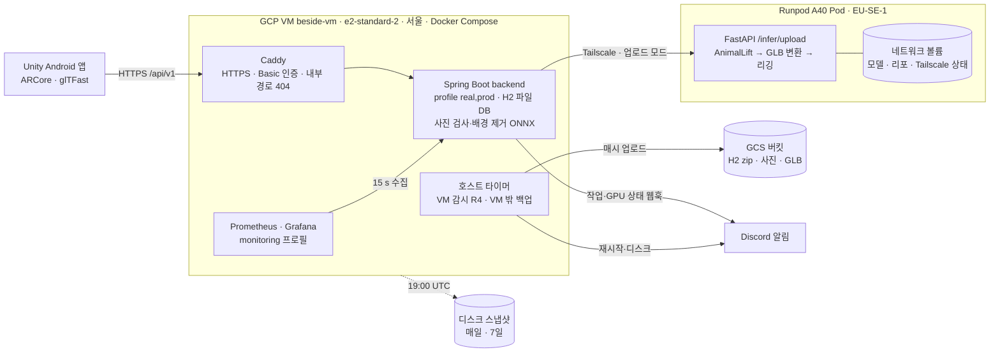

# 최종보고서 — Beside: 사진 기반 반려동물 3D 재현과 AR 동행

- **기준일**: 2026-11-25 (초안). 리포 main `d6e25d1`, 운영 VM `625c2a5`([deploy/README.md](../../deploy/README.md) 'GCP 메인 서버'). 발표 2026-12-04([PLAN.md](../PLAN.md) 5단계).
- **팀 트랙**: Backend(Spring API·작업 상태·저장·워커·배포), Unity(Android AR 앱), 3D Generation(AnimalLift 추론·GLB 변환).
- **표기**: **[구현됨]** 코드·시험이 리포에 있고 실행됨 / **[적용]** 운영에 켜 둠 / **[실험 결과]** 측정값과 조건이 기록됨 / **[계산]** 측정값으로 계산 / **[가설]** 확인 안 한 해석 / **[제안값]** 확정 전 기준 / **[계획]** 아직 안 함 / **머지됨·증빙 없음** 코드는 main 에 있으나 실행 증빙이 리포에 없음.
- 모든 수치는 링크한 원문에서 옮겼다. 원문에 없는 수치는 쓰지 않았다.

---

## 1. 문제와 목표

**문제.** 반려동물 사진 몇 장으로 그 동물을 3D 로 재현하고, 휴대폰 AR 로 곁에 두고 싶다([README.md](../../README.md)). 사진 → 3D 생성은 GPU 가 필요하고 오래 걸리며, 결과를 앱이 바로 쓸 수 있는 파일(GLB)로 넘겨야 한다.

| 목표 | 기준 | 근거 |
|---|---|---|
| MVP 전체 흐름 | 갤러리 → 업로드 → 폴링 → GLB 다운로드·캐시 → AR 배치 | [ARCHITECTURE.md](../ARCHITECTURE.md) '데이터 흐름', [PLAN.md](../PLAN.md) 1·2단계 |
| 3D 품질 | 얼굴 형태·귀·체형 비율·털 색상·무늬·텍스처 번짐 6항목, 평가자 2명 이상 | [PLAN.md](../PLAN.md) 3단계 DoD, [generation/README.md](../../generation/README.md) |
| 수치 측정 | 생성 시간·GPU 메모리·모델 크기·앱 로딩·FPS | [METRICS.md](../METRICS.md) |
| 멘토·교수 피드백 | "쏘카 수준 트래픽 목표(지표 5종·장애 시나리오 5종)", "부하·장애 시험도 배포 환경에서" | [PLAN.md](../PLAN.md) '부하·운영', [TRAFFIC_MODEL.md](../perf/load/TRAFFIC_MODEL.md) |

- 트래픽 목표 T3(쏘카 수준)는 MAU 약 100만 명(증권 보고서 추정)과 우리 가정(DAU/MAU 0.15 등)으로 만든 값이다: 피크 생성 3,600건/h, 평상시 약 37 RPS [가정·파생] ([TRAFFIC_MODEL.md](../perf/load/TRAFFIC_MODEL.md) 1~3절).
- 생성 모델은 AnimalLift 로 정했다. 같은 GPU(RTX 4060 Ti)에서 1장당 SF3D 0.67 s, TripoSR 1.63 s, AnimalLift 5.31 s 로 가장 느리지만, 고정 토폴로지(정점 4,310)와 털 정보(`hair.npz`)를 주는 것은 AnimalLift 뿐이라 리깅·털에 쓸 수 있다 [실험 결과] ([모델 비교](../../generation/experiments/2026-11-04_model-comparison.md)). 이 조사의 시간 정의는 METRICS 와 달라 exp-01 값과 직접 비교하지 않는다([experiments/README](../../generation/experiments/README.md)).

## 2. 시스템 구성

Unity 는 Spring 공개 API(v1)만 부르고, Spring 의 real 워커가 Tailscale 사설망 너머 추론 서비스를 부른다([ARCHITECTURE.md](../ARCHITECTURE.md), [deploy/README.md](../../deploy/README.md)).

| 구성 | 값 | 근거 |
|---|---|---|
| VM | GCP `asia-northeast3-a`, e2-standard-2(2 vCPU·8 GB), 고정 IP + `beside-team.duckdns.org` | [deploy/README.md](../../deploy/README.md) 'GCP 메인 서버' |
| GPU | Runpod A40 Pod(Secure, EU-SE-1, $0.59/h), 볼륨 `z4kgw4v5zi`, Pod 안 Tailscale userspace | [vm-5th](../perf/load/2026-11-21_vm-5th.md) 1절, [ARCHITECTURE.md](../ARCHITECTURE.md) '배포 가정' |
| 추론 동시성 | backend 추론 슬롯 1(`inference.max-concurrency` 기본 1), 시간 초과 120 s | [ARCHITECTURE.md](../ARCHITECTURE.md) '프로파일'·'배포 가정'(동시성) |

## 3. 구현

| 영역 | 내용 | 상태 | 근거 |
|---|---|---|---|
| API v1.0 (태그 `api-v1.0`, 3ae3ca1, 2026-11-21) | 생성·조회·에셋·retry·목록·healthz, 오류 봉투, 대표 사진 검사 400 코드 7개, `hair` variant 삭제, 429 이름만 예약 | [구현됨] `JobV1ContractTest` | [CHANGELOG](../api/CHANGELOG.md) v1.0 |
| API v1.1 (`api-v1.1`, fe10683) | 생성·retry 에 503 `QUEUE_FULL` + `Retry-After`. N=19, 165 s [계산: W=180 s 규칙] | [구현됨]. 기본 꺼짐, 운영에서도 꺼 둠(마지막 확인 2026-11-21 5차 복구 때, [vm-5th](../perf/load/2026-11-21_vm-5th.md) '운영 보호'). 켜기는 Unity 새 빌드 설치 뒤 [계획] | [CHANGELOG](../api/CHANGELOG.md) v1.1 |
| API v1.2 (`api-v1.2`, f6dfa66, 2026-11-22) | 대기 정보(`queue`·`estimate`), 취소, 공유 링크·웹 3D/AR 뷰어, 보관함, 관리 화면, 품질 평가, 오류 코드 5개. 작업 삭제·썸네일은 미룸 | [구현됨] 서버·웹. 앱에서 쓰기는 [계획] | [CHANGELOG](../api/CHANGELOG.md) v1.2 |
| 워커·저장 | profile `mock`·`real`, real 워커가 `/infer/upload` 호출, prod 에서는 GPU 꺼짐이면 최대 30분 PENDING 대기(`inference.offline-wait-ms`), 재시작 때 진행 중 작업은 `INTERNAL_ERROR`, `job_runs`·`events.jsonl` 측정 | [구현됨] | [ARCHITECTURE.md](../ARCHITECTURE.md) |
| 대표 사진 검사·전처리 | 디코딩·해상도·개/고양이 1마리·크기·밝기·선명도 검사 후 크롭·배경 제거(YOLOX-s, U²-Net, ONNX Runtime). real·prod 기본 켬 | [구현됨]. CC0 6장 판정이 사람 기대와 6/6 일치 [실험 결과] | [photo-check](../preprocess/2026-11-05_photo-check.md) 4절 |
| 배포 | Docker Compose + Caddy(HTTPS, Basic 인증, v0·H2 콘솔·Swagger 404). 공개 경로 시험 61개 | [구현됨·적용] 2026-11-13 | [deploy/README.md](../../deploy/README.md) |
| 백업 | H2 매시 5분·48개 + 매시 20분 GCS 업로드(사진·GLB 는 하루 1번), 디스크 스냅샷 매일 19:00 UTC·7일 | [적용] 2026-11-20. 스냅샷 READY 5개 확인 | [REDUNDANCY.md](../ops/REDUNDANCY.md) 3·5절 |
| 감시·알림 | VM 감시 R4(health 3번 실패 → 재시작, 디스크 80 %), Pod 감독 루프 R7, Discord 알림: 추론 멈춤(🐢)·토큰 불일치(🔑)·모델 로드 실패(🧩)·계속 꺼짐(🧱) | [적용] 2026-11-20. 외부 가동 감시 R3 는 [계획] | [RUNBOOK.md](../ops/RUNBOOK.md) |
| 안전장치 | prod 는 DB 파일이 없으면 시작 거부, 컨테이너의 메타데이터 서버 차단, 버킷 만들기만 되는 전용 서비스 계정 | [적용] 2026-11-20 | [failure-drills](../ops/2026-11-20_failure-drills.md) '결과에서 나온 대응' |
| 3D 생성 | AnimalLift 베이스라인(`5d364cf`), `convert_asset.py`(OBJ+PNG → GLB), 털 맵을 GLB 안 `extras.beside` 로(PR #25), 리깅 템플릿 정점 번호 맞추기 `reorder_rig_template.py`(PR #30), 털 맵 끄기 `BESIDE_EMBED_HAIR=0` | 코드 [구현됨]: 모델 없이 도는 `test_app.py`. gltf-validator 검사는 [계획] | [generation/README.md](../../generation/README.md), [GLB_SPEC](../asset/GLB_SPEC.md), [tools/README](../../generation/tools/README.md) |
| Unity 앱 | 업로드·2초 폴링·캐시·glTFast 로드·AR 평면 배치(1마리)·애니메이션 클립 5종·셸 털 v2·UI 시안 E(7개 화면) | **머지됨·증빙 없음**: 셸 털 v2·시안 E 는 컴파일만 확인. 기기 영상·logcat·`metrics.csv` 가 리포에 없다 | [unity/README.md](../../unity/README.md) '상태', [unity/CHANGELOG.md](../../unity/CHANGELOG.md) |

- Unity README 의 "[검증됨] 실제 Android 기기" 줄은 2026-10-14 PR #1 때 적은 것이고, 기기 이름·날짜·빌드 커밋·영상이 리포에 없다(2026-11-25 확인, [unity/README.md](../../unity/README.md)). 그래서 이 보고서는 앱을 [구현됨]으로 쓰지 않는다.

## 4. 실험

### 4.1 exp-01 베이스라인 [실험 결과]

조건: 2026-11-17, Runpod A40 48GB(EU-SE-1), AnimalLift `5d364cf`, 사진 1장/작업, 리깅 끔, 표본 4건. 2026-11-18 2차 부하 시험에서 같은 사진 `dog.jpg` 반복 539건을 더함([exp-01](../../generation/experiments/2026-11-17_exp-01_baseline-runpod.md)).

| 항목 | 표본 4건 | 2차 539건 |
|---|---|---|
| `inferMs` | 3,850~5,728 | 중앙값 3,761, p95 4,326 |
| `convertMs` | 846~1,133 | 중앙값 816, p95 987 |
| `gpuPeakMB` (torch) | 5,120 (1건, Pod 직접) | 5,120~5,128 (nvidia-smi 프로세스 최대 9,463 MiB) |
| 정점 / 삼각형 | 4,310 (1건) / 7,774 (4건) | 같음 |
| `modelParams` | 153,833,642 (1건) | 같음 |
| GLB 크기 (털 맵·리깅 없음) | 1,310,876~1,327,400 B (3건, VM 경유) | 1,326,748 B |
| 모델 로드 | 31.3 s (첫 실행) | — |
| 작업 전체 (공개 주소) | 12~16 s. `processingMs` 10.3~13.4 s 가 모델보다 5~7 s 긴 것은 VM↔Pod 중계 전송으로 봄 [가설: 나눠 재지 않음] | — |
| 품질 6항목 | 비어 있음 [계획] | 채점 안 함 |

- 계획 단계의 위험 "생성 시간 수 분"([PLAN.md](../PLAN.md) '위험과 대응')과 달리 한 건은 12~16 s 였다. exp-01 뒤 2026-11-21 에 `inference.timeout-ms` 를 600 s → 120 s 로 줄였다([CHANGELOG](../api/CHANGELOG.md) v1.0 #7, [PLAN.md](../PLAN.md) 3단계).

### 4.2 부하 시험 1~5차 [실험 결과]

공통 조건: 서버는 운영 VM(GCP e2-standard-2 서울)에 부하용 backend 를 띄워 잼(운영 backend 는 그동안 멈추고 복구 뒤 DB 해시 확인). 부하 발생기는 Runpod CPU Pod(US-CA-2)의 k6 v2.3.0. **실행마다 1회**.

**API 계층 — 1차, 2026-11-18** ([vm-1st](../perf/load/2026-11-18_vm-1st.md) 요약). 조건: `mock,prod`(PROCESSING 60 s), 사진 0.8 MB·GLB 1.5 MB 합성, 부하 발생기 → VM 왕복 153.6 ms.

| 시험 | 범위 | 규칙상 판정 | 관찰 |
|---|---|---|---|
| A1 혼합 흐름 | 25 → 9,000명(185 요청/s), 단계마다 8분 | 통과 단계 없음(`dropped_iterations` 12) | 5xx·연결 오류 0, 폴링 p95 157~160 ms, VM CPU 단계 평균 최대 51 % |
| A2 폴링 포화 | 100 → 1,800 요청/s, 단계마다 5분 | 마지막 통과 300 요청/s | 900 요청/s 는 지연 기준 안 유지(VM CPU 평균 85.8 %), 1,200 요청/s 에서 무너짐(처리 580~650/s, 오류 1.3~2.7 %) |
| A3 업로드 0.8 MB | 1 → 20 /s | 6단계 모두 통과 | 유지 구간 p95 약 0.36 s, VM CPU 단계 평균 최대 39 % |
| A4 GLB 1.5 MB 받기 | 1 → 15 /s | 10 /s(120 Mbps)까지 통과 | 15 /s 실패는 Pod 경로 상한(약 210 Mbps) 근처 [가설] |

- VM CPU 를 가장 많이 쓴 것은 Spring 이 아니라 Caddy 였다. A2 900 요청/s 에서 Caddy 85~90 %, 1,200 요청/s 부터 132~143 %(코어 하나 = 100 %) [실험 결과]. Caddy(TLS·프록시)를 병목으로 보는 것은 이 CPU 몫에서 나온 해석이다 [가설] ([vm-1st](../perf/load/2026-11-18_vm-1st.md) 요약).

**GPU 계층 — 2~5차** (공통: real,prod, A40 1대, 서울 VM ↔ 스웨덴 Pod Tailscale 직접 연결, 작업마다 `dog.jpg` 1장 반복, 사진 검사·크롭 켬).

| 차수 | 시험 | 결과 | 근거 |
|---|---|---|---|
| 2차 (2026-11-18) | G0r·G1r·G3r 5실행 | 539건 모두 COMPLETED, 재시도·5xx 0. 과부하에서 작업 시작 간격 S_busy 8.81~9.06 s(397~409건/h). 그때 GPU 사용률 평균 22.7 % | [vm-2nd](../perf/load/2026-11-18_vm-2nd.md) 요약 |
| 3차 (2026-11-18 UTC) | Pod uvicorn keep-alive 5 → 75 s | 처리 중앙값 9.09 → 8.22 s(−9.6 %), 전송 등 4.41 → 3.56 s | [vm-3rd](../perf/load/2026-11-19_vm-3rd.md) 요약 |
| 3차 | F2-real: 추론 서비스 `kill -9` | 잃은 작업 0(마지막 시도 기준), kill → UP 146.7 s, 처리 중 1건은 `INFERENCE_UNAVAILABLE` → retry 로 완료 | [vm-3rd](../perf/load/2026-11-19_vm-3rd.md) 요약 |
| 4차 (2026-11-19 UTC) | G3r c=1 과부하 | S_busy 8.67 s → **415건/h**, 대기 평균 60.8 s·최대 205 s | [vm-4th](../perf/load/2026-11-20_vm-4th.md) 요약 |
| 4차 | G2r c=2, 같은 Pod | 센 하한 **495건/h** = c=1 의 1.19배 이상 | [vm-4th](../perf/load/2026-11-20_vm-4th.md) 요약 |
| 4차 | F1b-real 다시(PR #11) | 남은 작업 폴더 3 → 0, `DELETE` 5xx 0 | [vm-4th](../perf/load/2026-11-20_vm-4th.md) 요약 |
| 5차 (2026-11-21) | 털 맵 GLB, 상한 0 | S_busy 8.81 s → **409건/h**, GLB 1,923,996 B. 만든 383건 중 132건(34.5 %)이 600 s 흐름 시간 초과 | [vm-5th](../perf/load/2026-11-21_vm-5th.md) 요약 |
| 5차 | 상한 N 19, `Retry-After` 167 s | 337건 중 51건(15.1 %) 503 `QUEUE_FULL`, 받아들인 286건 모두 COMPLETED, 최대 대기 176.3 s. 합격 기준 1~5 통과. 상한이 처리량을 깎지 않음(S_busy 비 0.9999) | [vm-5th](../perf/load/2026-11-21_vm-5th.md) 요약 |

- 5차 S_busy 로 다시 계산해도 N 은 19, `Retry-After` 는 167 s 였다. 사용자가 165 s 유지로 정했다(2026-11-21) [계산] ([vm-5th](../perf/load/2026-11-21_vm-5th.md) 요약).

**용량 계산** [계산] — 잰 S_busy 8.67 / 8.81 s, c = ⌈λ·S / 0.7⌉([TRAFFIC_MODEL.md](../perf/load/TRAFFIC_MODEL.md) 5.1절).

| 등급 | 피크 생성 λ [가정·파생] | 필요 GPU | 이용률 ρ |
|---|---|---|---|
| T1 팀 내부 | 10건/h | 1 / 1 | 0.024 / 0.024 |
| T2 공개 베타 | 120건/h | 1 / 1 | 0.289 / 0.294 |
| T3 쏘카 수준 | 3,600건/h | **13 / 13** | 0.667 / 0.678 |
| T3 스파이크(15분) | 10,800건/h | 38 / 38 | 0.684 / 0.696 |

- 13대는 처리량이 GPU 대수에 비례한다고 놓은 계산이다. 실제로 쓴 GPU 는 언제나 A40 1대였다([TRAFFIC_MODEL.md](../perf/load/TRAFFIC_MODEL.md) 5.1절 '한계').

### 4.3 장애 훈련 (2026-11-20) [실험 결과]

조건: 운영 VM + A40 Pod. 운영 중단 1차 77분·2차 15.5분, 시나리오마다 1회. 2차는 대응을 배포한 뒤 다시 잰 것이다. 외부 탐침은 1초마다 공개 healthz([failure-drills](../ops/2026-11-20_failure-drills.md)).

| ID | 장애 | 대응 전 (1차) | 대응 뒤 (2차·5차) |
|---|---|---|---|
| FD1 | backend `kill -9` | 0.36 s 뒤 재시작, 19.1 s 뒤 healthz 200, 외부 끊김 17.8 s | — |
| FD2 | backend 멈춤(SIGSTOP) | 재시작 없음, 189 s 무응답 | VM 감시 R4 가 멈춘 지 112 s 뒤 재시작 |
| FD3 | VM stop → start | 외부 끊김 82.8 s, Tailscale·GPU 자동 복귀 | — |
| FD6 | VM 통째 유실 → 스냅샷으로 다른 zone 복구 | 서비스 응답 89 s, 운영 설정 145 s, DB 해시 일치. 고정 IP 전환은 안 함 | — |
| FD16a | 멈춘 Pod 가 GPU 를 못 받음 | 같은 볼륨으로 새 Pod, 98 s 뒤 GPU UP | — |
| FD16b | 부하 중 Pod 정지 | 끊긴 요청이 슬롯을 600 s 잡음, 대기 작업 최대 602 s | 5차: 끊긴 요청 52 s 에 포기, 대기 5건 모두 완료·최대 74.3 s |
| R7 | Pod 추론 서비스 `kill -9` | 감독 루프 없음(누가 다시 띄울 때까지 꺼짐) | 감독 루프가 다시 띄움, kill → UP 41 s, 사람 손 없음 |
| FD13 | healthz 는 UP, 추론만 멈춤 | 감지 없음 | 🐢 알림 2분 14초 |
| FD17 | 추론 토큰 불일치 | GPU 상태 UP 그대로 | 🔑 알림 9.8 s |
| FD18 | 모델 로드 실패 | "로딩 중"과 구별 안 됨 | 🧩 알림, 바로잡은 뒤 UP 40 s(1차 52.6 s) |
| FD5 | DB 파일 유실 | 빈 DB 를 조용히 만들고 healthz 200 | 5차: 시작 거부, 🧱 44.6 s 뒤, 복구 뒤 14.8 s 에 healthz 200. RPO = 백업 간격 |
| FD4 | 디스크 가득 참 | 감지 없음, 원인과 다른 `CONVERSION_FAILED` | `INTERNAL_ERROR` 로 고침 [구현됨], 다시 재현은 [계획] |

- 5차 값의 근거: [vm-5th](../perf/load/2026-11-21_vm-5th.md) 요약·7절. 운영이 아닌 훈련 backend 였고, 알림은 팀 채널이 아니라 VM 안 수집기로 갔다.
- **결론: 가장 위험한 장애는 감지되지 않는 장애였다.** FD13·FD17·FD4·FD5·FD15 는 모두 공개 healthz 가 200 이었고 GPU 알림도 없었다 [실험 결과] ([failure-drills](../ops/2026-11-20_failure-drills.md) 요약).
- **대응**: 추론 감시 알림(🐢·🔑·🧩), DB 없으면 시작 거부(🧱), VM 감시 R4(멈춤 재시작·디스크 80 %), Pod 감독 루프 R7, VM 밖 백업·스냅샷 [적용]. 남은 공백: VM·Caddy 가 죽으면 알림이 없다 → 외부 가동 감시 R3 [계획] ([RUNBOOK.md](../ops/RUNBOOK.md) '알림·감시').

### 4.4 발표 GPU 리허설과 운영 지표 (2026-11-25) [실험 결과]

조건: 운영 VM(main `625c2a5`, real,prod, backend 재시작 없음) + 새 A40 Pod(리포를 main `d6e25d1` 에 고정), 공개 주소로 `scripts/e2e_mock.sh`, 사진 `dog.jpg` 1장, 운영 DB 의 시험 작업 9건, 1회([리허설 기록](../ops/data/2026-11-25_demo-gpu-rehearsal/README.md)).

| 항목 | 값 |
|---|---|
| Pod 생성 → VM 이 UP 을 봄 | 89.6 s (DOWN → LOADING 43.8 s) |
| 첫 작업 클라이언트 e2e | 22.1 s (업로드 749 ms, 대기 21.2 s; 서버 `processingMs` 17,988, `inferMs` 8,353) |
| 9건 | 모두 COMPLETED, 모두 `modelVersion` 끝 `+rig`(리깅 성공), GLB 2,100,924 B, `gpuPeakMB` 5,120 |
| `processingMs` | 중앙값 11,079 ms, 첫 작업을 빼면 8,574~11,880 ms |
| 1.2 s 간격으로 겹친 4건 `totalMs` | 11,785 → 19,779 → 30,174 → 40,239 ms (앞 작업이 끝날 때마다 한 칸씩 밀림) |
| Pod 비용 | 약 5분, 약 $0.05 [계산] |

멘토 지표 5개 — 운영 Prometheus, 06:00 UTC 기준 지난 10분([prometheus-0600Z.txt](../ops/data/2026-11-25_demo-gpu-rehearsal/prometheus-0600Z.txt)):

| 지표 | 값 |
|---|---|
| 생성 성공률 | 1 (COMPLETED 9건) |
| 생성 시간 평균 / p95 (METRICS §5.3, PROCESSING 시작 → 완료) | 11.3 s / 28.5 s (p95 는 히스토그램 버킷 보간값, 실제 최대 `processingMs` 18.0 s). 대기 포함 접수 → 완료는 19.6 s / 53.3 s(보간값, 실제 최대 `totalMs` 40.2 s) |
| 대기열 길이 최대 | 3 (pending 2 + processing 1) |
| 에셋 다운로드 실패율 | 0 (정상 13번) |
| API 응답 시간 p95 | `POST /api/v1/jobs` 2.26 s, 조회·에셋·healthz 약 0.024 s |

- Grafana 는 같은 날 05:52 UTC 운영 VM 에 띄웠다 [적용] ([deploy/README.md](../../deploy/README.md) '모니터링'). 위 값의 근거는 Prometheus 질의 원본이다. Grafana 화면 확인과 캡처는 [계획] 이다.

## 5. 결과와 한계

**보인 것.**
- 공개 주소 → VM → A40 → GLB 의 서버 쪽 전체 흐름이 실제 모델로 돈다. 한 건 12~16 s(exp-01), 2차 539건 모두 COMPLETED [실험 결과].
- GPU 1대·슬롯 1개는 시간당 약 409~415건을 처리한다. 넘치는 요청은 큐 상한(N 19)으로 바로 거절해 받아들인 작업의 대기를 176.3 s 안에 묶었다 [실험 결과] (4.2절, [vm-5th](../perf/load/2026-11-21_vm-5th.md)).
- 장애 18가지를 배포 환경에서 재현했고, 감지 공백 대부분을 알림·감시로 메웠다 [실험 결과·적용] (4.3절, [failure-drills](../ops/2026-11-20_failure-drills.md)).

**한계.**

| 한계 | 근거 | 뜻 |
|---|---|---|
| 사진은 첫 1장만 쓴다 | [app.py:776](../../generation/inference_service/app.py) `image_paths[0]` | 앱이 사진 10장까지 올려도 3D 는 1장으로 만든다 |
| 같은 사진 반복 | 2~5차·리허설 모두 `dog.jpg` | 같은 변환 설정 안에서는 출력(정점·GLB 크기)이 매번 같다(GLB 는 털 맵·리깅이 붙으며 1,326,748 → 1,923,996 → 2,100,924 B). 사진 10장 이상 측정은 [계획] ([PLAN.md](../PLAN.md) 4단계) |
| 대부분 1회 실행 | 각 부하·훈련 문서 '한계' | 실행 사이 편차를 모른다 |
| 앱·기기 측정 0건 | [METRICS.md](../METRICS.md) 상태: `metrics.csv`(FPS·`memMB` 포함) 0건 | 앱 로딩 시간·FPS·앱 e2e 수치가 없다. 기기 영상·logcat 도 없다 |
| 품질 채점 0건 | exp-01 품질 칸 빔, exp-02 없음([PLAN.md](../PLAN.md) 3단계) | 얼굴·귀·체형·털 색·무늬를 수치로 말할 수 없다 |
| 리깅·애니메이션 범위 | PLAN 5단계 DoD "향후 과제로만" ↔ 리허설 9건 모두 `+rig` | 발표에서 어떻게 다룰지는 팀 결정 [계획]. 리깅 GLB 의 기기 확인도 [계획] |
| 폴링 계층 상한 | 1차 A2: 1,200 요청/s 붕괴, CPU 최다 사용 Caddy | 부하 발생기가 미국 서부(왕복 153 ms)라 한국 리전 재측정 [계획] |
| GPU 1대 | [TRAFFIC_MODEL.md](../perf/load/TRAFFIC_MODEL.md) 5.1절 | T3 13대는 선형 가정 [계산]. 여러 대 측정 0회 |
| GPU 가 대부분 쉼 | 2차: 과부하에서도 사용률 평균 22.7 % | 슬롯 시간의 상당 부분이 서울 ↔ 스웨덴 전송이다 |
| 큐 상한은 운영에서 꺼짐 | [CHANGELOG](../api/CHANGELOG.md) v1.1 | `QUEUE_FULL` 을 아는 Unity 빌드를 기기에 깐 뒤 켬 [계획] |
| VM·Caddy 다운 알림 없음 | [RUNBOOK.md](../ops/RUNBOOK.md) | 외부 가동 감시 R3 [계획] |

## 6. 개선과 다음 단계 [계획]

### 6.1 서버 이중화 — 계획만, 실행 전

**2026-11-25 사용자 결정**: 계획만 세운다. 실행은 사용자가 나중에 단계별로 명령한다([REDUNDANCY.md](../ops/REDUNDANCY.md) 6.2절).

- **지금**: API·VM 은 cold standby(스냅샷 + VM 밖 백업 + 연습한 복구 절차), GPU 는 Pod 안 자동 재시작 + 새 Pod 절차([REDUNDANCY.md](../ops/REDUNDANCY.md) 결론).
- **설계안 점수**(30점 만점): D1 warm standby 24, D2 active-active 11, D3 GPU 먼저 20 → D1 을 단계로 나누고 D3 의 코드 0줄 GPU 대비를 접붙임([90-synthesis](../ops/data/2026-11-25_redundancy-design/90-synthesis.md) B-1·B-2).

| 단계 | 내용 | 목표·효과 |
|---|---|---|
| Phase 0 | R3 외부 가동 감시, 문서 먼저, 백업 계정에 버킷 읽기 권한 | VM·Caddy 장애 감지: 없음 → 메일 3~4분 |
| Phase 1 | 백업 주기 단축(DB 5분, 사진·GLB 매 실행), 다른 zone 대기 VM, 계획 전환·되돌리기 실측 | 계획 전환 목표 ≤ 3분 [제안값]. DB RPO 최대 약 75분 → 약 8분 [계산] |
| Phase G | 발표 GPU 대비: Pod 1대를 일찍 켬, Pod 코드 태그 고정, 녹화 영상 | 4.4 리허설에서 절차 1회 |
| Phase 2 (발표 뒤) | warm 대기(5분마다 당겨 오기) + 비계획 전환 | 비계획 전환 ≤ 10분 [제안값] |
| Phase 3 | GPU 먼저: 추론 주소 목록(G1) → 6차 부하로 Pod 2대 처리량 실측 → 조건부 상태 전이·PostgreSQL·VM 2대 | `N_eff = 19 × UP 대수` 검증 [가설] |

- 출처: [REDUNDANCY.md](../ops/REDUNDANCY.md) 6.3·6.4절, [90-synthesis](../ops/data/2026-11-25_redundancy-design/90-synthesis.md) B절. 하지 않기로 한 것(발표 전 active-active, 자동 전환, 운영에서 큐 상한 켜기 등)도 같은 곳에 있다.

### 6.2 그 밖의 개선

- **GPU 풀**(B9): 추론 주소를 목록으로 받아 Pod 여러 대를 쓴다 [계획] ([PLAN.md](../PLAN.md) 4b, [REDUNDANCY.md](../ops/REDUNDANCY.md) 4절).
- **전송 줄이기**: VM 과 가까운 GPU 또는 왕복을 줄이는 전송 [가설] ([exp-01](../../generation/experiments/2026-11-17_exp-01_baseline-runpod.md) 6절).
- **품질 개선 실험**: exp-03 입력 전처리 3안 비교(틀만 있음), exp-04 [계획] ([experiments/README](../../generation/experiments/README.md)).
- **부하 시험 남은 것**: A1 재측정, 한국 리전 부하 발생기, A3 large, A5·A6 [계획] ([90-synthesis](../ops/data/2026-11-25_redundancy-design/90-synthesis.md) A-4).
- **운영 정책**: 보존 정책 자동 삭제(#23), 요청 수 제한(#22) [계획] ([CHANGELOG](../api/CHANGELOG.md) '다음 태그 전'(#23)·v1.0 '예약'(#22)).

### 6.3 발표까지 남은 일 (사람 손이 필요한 must)

출처: [90-synthesis](../ops/data/2026-11-25_redundancy-design/90-synthesis.md) A-1, [CHECKLIST.md](../CHECKLIST.md) 0절.

| # | 할 일 | 담당 |
|---|---|---|
| M5·M6 | Android 빌드 환경(Build Support·SDK·adb), Unity 6 에디터 Play·APK | Unity |
| M7·M8 | 서버 GLB(리깅 + 털 맵)를 기기에서 확인, 실기기 전체 흐름 영상과 logcat | Unity·3D |
| M9 | 앱 `metrics.csv` 10회 → 관리 API 로 올리기 | Unity → Backend |
| M10 | exp-02 품질 채점: 사진 3마리 이상, 6항목, 평가자 2명 이상 | 3D·전원 |
| M2 | 리깅·애니메이션을 발표에서 어떻게 다룰지 결정 | 전원 |
| M4·M13 | 시연 Pod 코드를 태그로 고정, R3 알림 채널 만들기(콘솔) | Backend·사람 |
| M15·M16 | 슬라이드(문제 → 구현 → 실험 → 결과 → 개선), GPU 를 켠 리허설 | 전원 |

- 멘토 요구별 답은 [2026-11-25_mentoring-response.md](2026-11-25_mentoring-response.md) 에 따로 정리한다.

---

## 근거 문서

- 개요: [README.md](../../README.md), [ARCHITECTURE.md](../ARCHITECTURE.md), [PLAN.md](../PLAN.md), [CHECKLIST.md](../CHECKLIST.md), [METRICS.md](../METRICS.md)
- 계약: [api/CHANGELOG.md](../api/CHANGELOG.md), [asset/GLB_SPEC.md](../asset/GLB_SPEC.md)
- 배포·운영: [deploy/README.md](../../deploy/README.md), [ops/RUNBOOK.md](../ops/RUNBOOK.md), [ops/REDUNDANCY.md](../ops/REDUNDANCY.md), [ops/2026-11-20_failure-drills.md](../ops/2026-11-20_failure-drills.md), [2026-11-25 리허설](../ops/data/2026-11-25_demo-gpu-rehearsal/README.md), [이중화 종합](../ops/data/2026-11-25_redundancy-design/90-synthesis.md)
- 부하 시험: [TRAFFIC_MODEL.md](../perf/load/TRAFFIC_MODEL.md), [1차](../perf/load/2026-11-18_vm-1st.md), [2차](../perf/load/2026-11-18_vm-2nd.md), [3차](../perf/load/2026-11-19_vm-3rd.md), [4차](../perf/load/2026-11-20_vm-4th.md), [5차](../perf/load/2026-11-21_vm-5th.md)
- 전처리: [preprocess/2026-11-05_photo-check.md](../preprocess/2026-11-05_photo-check.md)
- 3D: [generation/README.md](../../generation/README.md), [exp-01](../../generation/experiments/2026-11-17_exp-01_baseline-runpod.md), [모델 비교](../../generation/experiments/2026-11-04_model-comparison.md), [tools/README](../../generation/tools/README.md), [inference_service/app.py](../../generation/inference_service/app.py)
- Unity: [unity/README.md](../../unity/README.md), [unity/CHANGELOG.md](../../unity/CHANGELOG.md)
