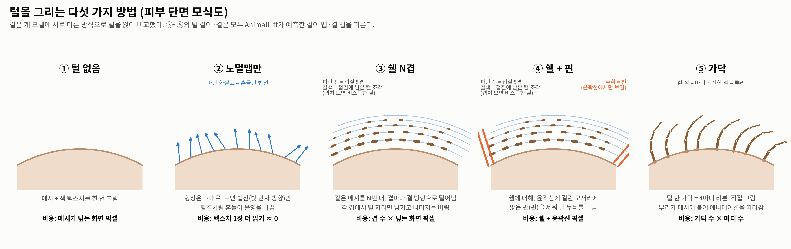

# 털 표현 (Fur Rendering)

상태: 쉘 털 v2·그림자 바닥면·GLB 털 맵 읽기 **[구현됨]**, 성능 **[실험 결과]**(브랜치 `Unity` 코드, SM-S947N 1대), 화질 옵션·부위별 털 **[계획]**. 코드는 `unity/Assets/Beside/Loader/`(앱)와 `unity/Assets/Beside/FurLab/`(측정 전용). 2026-11-17 브랜치 `Unity` 에 쓴 문서를 2026-11-21 main 에 옮기며 서버 쪽 설명을 main 의 변환기에 맞췄다. main 에 합친 코드의 에디터·기기 확인은 [계획].

AnimalLift가 만든 강아지 모델(정점 4,310개, 삼각형 7,774개, 색 텍스처 1장)에 털을 입히는 방법과 코드 구조를 정리한다. 측정값은 [experiments/2026-11-03_fur-benchmark.md](../experiments/2026-11-03_fur-benchmark.md)에 있다.



## 1. 털 정보가 오는 길

```text
사진 → 서버 → AnimalLift (메시 + 텍스처 + hair.npz)
                    │
   convert_asset.py: hair_maps(hair.npz → 털 길이 맵·결 맵 PNG) + embed_hair(GLB 안에 넣기)
                    │
   rig_transfer.py(템플릿이 있을 때): extras.beside 와 두 이미지를 리깅본으로 옮김
                    │
   base.glb  extras.beside { hairLengthImage, hairFlowImage, furLength }
                    ▼
앱 RuntimeModelLoader.TryReadEmbeddedHair(작업 흐름만) → ShellFurRenderer(_LengthMap, _FlowMap, _FurLength)
```

형식의 기준은 [GLB_SPEC §4.1](../../docs/asset/GLB_SPEC.md)(2026-11-21 결정 #14)이다. 아래는 앱 쪽에서 알아 둘 점이다.

- **털 길이 맵**(R): 0~1, `furLength` 에 곱한다. 코·발바닥 털을 0으로 만드는 것은 변환기 선택 기능 `--hair-meta`(추론 서비스 `BESIDE_HAIR_META`, **기본 꺼짐**)일 때만이다. 기본 출력은 `hair.npz` 그대로라 코·발바닥에도 털이 있을 수 있다.
- **털 결 맵**(RG): 털이 누운 방향. UV 공간의 접선 기준이라 셸 털 v2 는 메시의 TANGENT 로 방향을 잡는다. **main 의 변환기는 TANGENT 를 넣지 않는다.** TANGENT 가 없으면 v2 는 털 결(빗질)을 끄고(`comb * hasTangent`) 털을 법선 쪽으로 세운다. 브랜치 `Unity` 의 서버는 TANGENT 를 넣고(`add_tangents()`) G 부호를 뒤집지 않았지만, main 의 §4.1 은 G 부호를 뒤집는다. TANGENT 를 넣을지(서버 또는 앱의 `RecalculateTangents`)와 G 부호는 계약 결정·기기 나란히 비교가 먼저다 **[계획]**.
- AnimalLift의 털 정보는 가이드 털이 있는 텍셀(UV의 약 21%)에만 학습된 값이 있다. 가우시안 정규화 합성곱으로 가이드만으로 맵을 다시 채우는 것도 `--hair-meta` 선택 기능이다(기본은 원래 맵).
- GLB에 털 맵이 없으면 Inspector의 `fallbackHairLength`/`fallbackHairFlow`를 쓰고(`SampleScene` 에서는 비어 있음), 그것도 없으면 털을 그리지 않는다. Test Glb Url 로 연 GLB 는 안의 털 맵을 읽지 않는다(GLB_SPEC §4.1).

## 2. 비교한 방식

| 방식 | 어떻게 그리나 | 비용을 좌우하는 것 | 장점 / 한계 | 코드 |
|---|---|---|---|---|
| 노멀맵만 | 털결 모양 요철 정보로 빛 반사만 털처럼 보이게 한다 | 텍스처 1장 더 읽기 | 거의 공짜 / 윤곽이 매끈함 | FurVariants (생성 노멀맵) |
| **쉘 N겹** | 같은 메시를 N번 더 그리며, 한 겹마다 털 결 방향으로 조금씩 밀어낸다. 노이즈로 털 자리만 남긴다 | 겹 수 × 털이 덮는 화면 픽셀 | 짧고 빽빽한 털에 강함 / 가까이서 층이 보임 | `Loader/ShellFur*` |
| 쉘 + 핀 | 쉘에 더해, 윤곽선에 걸린 모서리마다 얇은 판을 세운다 | 쉘 + 윤곽선 픽셀 | 실루엣이 보송해짐 / +13% | `FurLab/FinFur*` |
| 가닥 | 털 한 가닥을 4마디 리본으로 직접 그린다. 뿌리는 메시 삼각형에 붙어 애니메이션을 따라간다 | 가닥 수 × 마디 수 | 긴 털·실루엣에 강함 / 수가 적으면 가시처럼 보임 | `FurLab/StrandFur*` |

앱 기본값은 **쉘 v2 20겹 + 자동 조절**이다. 가닥은 몸 전체에 쓰면 가시처럼 보여서, 꼬리·귀 같은 부위 전용 후보로 남겼다.

## 3. 쉘 털 v2 (`Custom/ShellFur`)

v1(털이 표면에 수직, 해시 격자, 픽셀 단위 조명)에서 다음을 바꿨다.

| 바꾼 점 | 이유 |
|---|---|
| 털을 결 맵 방향으로 눕힘 (`_FlowStrength` 0.8, `_Lie` 0.65) | 수직으로 선 털은 카펫·가시처럼 보였다 |
| 털 자리를 256² 밉맵 노이즈 텍스처로 정함 (`FurNoise.cs`) | 해시 격자는 멀리서 반짝이고 계단이 보였다 |
| Kajiya-Kay 털 하이라이트, 림 라이트, 뿌리 어둡게 | 털 방향을 따라 늘어지는 광택 |
| 조명을 정점 단위로 옮김 | 가까이서 픽셀 비용 절감 |
| 바깥 껍질부터 그림 | 가려진 픽셀을 GPU가 건너뛸 수 있게 |
| AlphaToMask(alpha-to-coverage) + MSAA | 털 끝이 부드러워짐. **MSAA를 끄면 털 대부분이 사라진다** |

셰이더 속성 기본값은 `_FurLength` 0.065(오브젝트 단위), `_Density` 700, `_Cutoff` 0.35, `_Gravity` 0.15, `_SpecStrength` 0.35 이다. 앱은 `RuntimeModelLoader.furMaterialTemplate`(`SampleScene` 에서는 `Dog_Fur_Mat`)을 복사해 쓰므로 실제 값은 그 머티리얼 것이다: `_FurLength` 0.025, `_Density` 800, `_Cutoff` 0.5, `_Gravity` 0.3, `_Lie` 0.65, `_SpecStrength` 0.35. 작업 흐름에서는 GLB 의 `furLength` 가 `_FurLength` 를 덮어쓴다(리포 샘플 로컬 변환 값 약 0.070, GLB_SPEC §4.1 '알려진 점').

### 쉘 수 자동 조절 (`ShellFurRenderer`)

쉘 비용은 화면 면적에 비례하므로, 펫이 화면을 많이 차지할 때 겹 수를 줄인다.

| 설정 | 기본값 | 뜻 |
|---|---|---|
| `shellCount` | 20 | 최대 겹 수 |
| `adaptiveShells` | 켬 | 자동 조절 |
| `reduceFrom` / `reduceTo` | 0.2 / 0.6 | 화면 차지율(바운딩 박스)이 20%부터 줄이기 시작해 60%에서 최소 |
| `minShells` | 10 | 최소 겹 수 |

가까이(화면 87%)에서 펫 1마리당 GPU 시간이 고정 20겹 대비 45% 줄었다(같은 라운드 비율 중앙값).

### 스프링 물리

펫이 움직이면 털이 뒤로 처졌다가 돌아온다(`inertia` 15, `stiffness` 60, `damping` 6, `maxBend` 0.8). 쉘·핀·가닥이 같은 스프링(`FurSpring`)을 쓴다.

## 4. 리깅 모델에서 털 맞추기

- `SkinnedMeshRenderer.BakeMesh(mesh, useScale: false)`로 매 프레임 현재 자세를 굽는다. 여러 털 렌더러가 있어도 `FurPose.GetMesh`가 프레임당 한 번만 굽는다.
- `useScale: false`로 구우면 렌더러 크기가 이미 정점에 들어가 있다. 이 메시를 `localToWorldMatrix`로 그리면 크기가 두 번 곱해져 털이 0.36배로 다리 사이에 그려졌다. 그래서 `FurPose.DrawMatrix`는 크기 1인 TRS로 그리고, 셰이더에 `_FurUnitScale`(= lossyScale)을 넘겨 털 길이를 맞춘다.
- 핀·가닥 셰이더는 메시 정점 버퍼(Raw GraphicsBuffer)를 직접 읽어, 자세가 바뀌어도 CPU 작업 없이 뿌리가 따라간다. 위치·노멀이 float32이고 같은 스트림에 있어야 한다.

## 5. 그림자 바닥면 (`ShadowCatcher.shader`)

AR 바닥 점(plane)을 숨기면 그림자를 받을 면이 없어 그림자가 사라졌다. 펫 아래 0.002 m 높이에 모델 최장 변 × 1.6 크기의 투명 사각형을 깔고, 그림자가 진 곳만 어둡게 그린다. 콜라이더는 없다(배치·터치에 영향 없음).

남은 문제: 그림자 가장자리 계단(aliasing)과 흰 점 깜빡임. 원인은 그림자 맵 해상도·캐스케이드 설정과 투명 면의 깊이 처리로 보이며, 아직 고치지 않았다.

## 6. 알려진 한계

| 문제 | 원인 | 상태 |
|---|---|---|
| 결과 색이 입력 사진과 다름 | 주원인은 AnimalLift의 텍스처 예측. 앱에서는 털 하이라이트가 색을 조금 밝게 함 | 원인 분석(generation/experiments 2026-11-05 기록), 개선 [계획] |
| 귀 가장자리 초록 번짐 | 배경과 섞인 텍스처 가장자리. 브랜치 서버에서 텍스처를 채워(pad) 줄였지만 일부 남음. main 에서는 `--pad-texture`/`BESIDE_PAD_TEXTURE=1` 선택 기능(기본 꺼짐) | 켤지 결정·마스크 확장 [계획] |
| 가까이서 쉘 층이 보임 | 쉘 방식의 한계 | 핀 또는 부위별 가닥 검토 |
| MSAA 의존 | alpha-to-coverage | MSAA 2x를 최소로 둠 (4x 대비 −32%) |
| 중저가 기기 미측정 | 측정은 최신 플래그십 1대 | 화질 옵션 + 추가 측정 예정 |

## 7. 화질 옵션 (계획)

멘토링(3차)에서 구형 기기 대응으로 화질 옵션을 제안받았다. 측정값(펫 1마리당 GPU 시간)을 근거로 다음 단계를 검토한다.

| 옵션 | 구성 | 가까이 ms | 멀리 ms |
|---|---|---:|---:|
| 낮음 | 노멀맵만 | 1.37 | 0.13 |
| 중간 | 쉘 8겹 | 12.4 | 1.64 |
| 높음 | 쉘 20겹 + 자동 조절 (현재 기본값) | 13.5 | 4.15 |

모두 MSAA 4x에서 잰 값이다. 가까이서는 자동 조절이 쉘을 10겹까지 줄이므로 중간과 높음의 차이가 작고, 차이는 멀리서 크다. MSAA를 2x로 내리면 가까이서 약 32% 더 줄어든다(쉘 16겹 기준). 중저가 기기에서 다시 재서 옵션 경계를 정한다.
