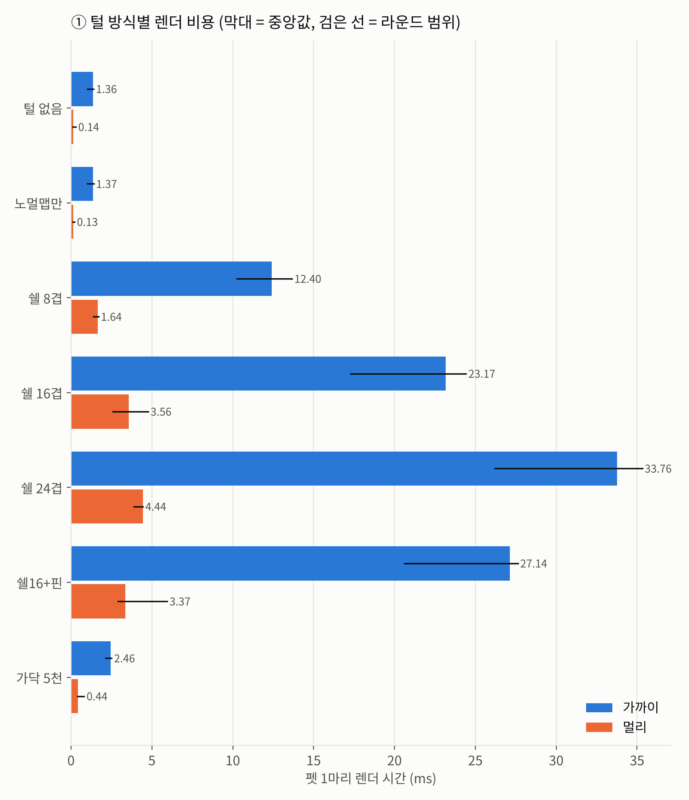
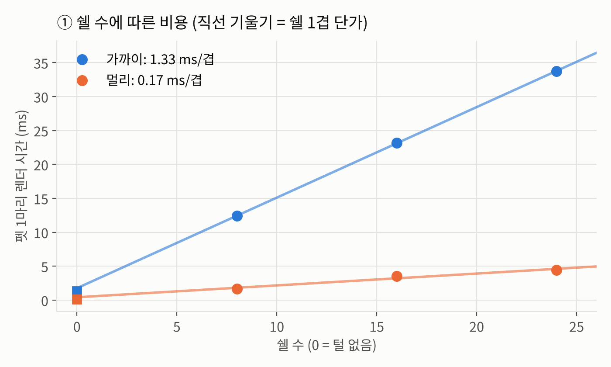
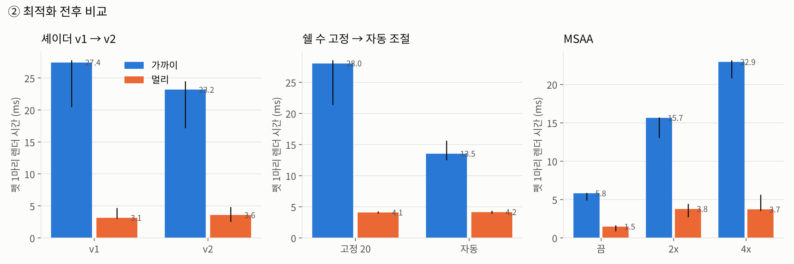

# 2026-11-03 털 렌더링 성능 측정

| 항목 | 값 |
|---|---|
| 날짜 | 2026-11-03 (1~3차 시험 측정 2026-11-02) |
| 담당 | Unity 트랙 |
| 코드 | `unity/Assets/Beside/FurLab/`, `unity/Assets/Beside/Loader/ShellFur*` |
| 커밋 | 측정 코드 = 연구용 프로젝트(2026-11-03). 이 리포에는 브랜치 `Unity` 4e6f190 으로 들어왔고(그때 경로 `unity/BesideApp/…`), 2026-11-21 main 에 `unity/` 경로로 옮겼다. main 에 합친 코드로는 다시 재지 않았다 |
| 환경 | Samsung SM-S947N, OpenGLES3(ANGLE), Unity 6000.6.0f1, URP MSAA 4x(조건별 변경) |
| 상태 | [실험 결과] |

털 방식(①)과 최적화(②)마다 펫 1마리를 그리는 GPU 시간이 얼마인지 실기기에서 쟀다. 지난 교수님 피드백("성능을 수치로 비교할 것")에 대한 답이다.

## 요약

- 쉘은 겹 수와 화면 면적에 비례한다. **가까이 1겹당 1.33 ms, 멀리 0.17 ms.** 30 FPS 예산(26.7 ms = 1000/30 × 0.8) 안에서 가까이 약 18겹까지 가능하다.
- 가닥 5천 개는 쉘 8겹의 20% 비용이지만 몸 전체에 쓰면 가시처럼 보인다. 노멀맵은 비용이 거의 없다.
- 핀을 더하면 쉘 대비 +13%.
- 최적화 효과(가까이, 같은 라운드 비율 중앙값): 쉘 셰이더 v1→v2 **−16%**, 쉘 수 자동 조절 **−45%**, MSAA 4x→2x **−32%**.
- 앱 기본값(쉘 20겹 + 자동 조절)은 가까이 13.5 ms, 멀리 4.2 ms.

## 조건

| 항목 | 값 |
|---|---|
| 기기 | Samsung SM-S947N (Xclipse 960), OpenGLES3(ANGLE on Vulkan), 1440×3120 @ 60 Hz |
| 모델 | AnimalLift 결과 1개 (정점 4,310 / 삼각형 7,774), Idle 자세, 거치대 고정 |
| 거리 | 가까이 = 펫이 화면의 약 87%, 멀리 = 약 20% (바운딩 박스 기준) |
| 라운드 | 조건당 3라운드, 라운드마다 조건 순서 변경. 두 묶음에 모두 있는 조건은 3~6회 |
| AR | 측정 중 ARSession의 30 FPS 고정 해제 |
| 발열 | 배터리 45°C 초과 시 43°C까지 대기(최대 90초). 1라운드 36~40°C → 이후 약 44°C |

## 지표: msPerPet

AR 앱은 30 FPS에 묶여 있고, 화면 갱신(16.7 ms) 단위로 프레임 시간이 끊겨서 FPS로는 방식 차이가 보이지 않는다. 그래서 펫(몸 + 털)을 한 프레임에 K번, 2K번 겹쳐 그려 GPU를 한계까지 쓰게 한 뒤 다음을 계산한다.

**msPerPet = (2K일 때 평균 프레임 시간 − K일 때 평균 프레임 시간) ÷ K**

msPerPet 은 FurLab 측정에만 쓰는 지표다([docs/METRICS.md](../../docs/METRICS.md) 의 항목이 아니고 `metrics.csv` 열도 아니다).

빼기에서 매 프레임 한 번만 드는 비용(AR 카메라 화면, UI)과 화면 동기화 대기가 빠지므로, 펫 1마리의 GPU 시간이 남는다. K는 조건마다 자동으로 정한다(프레임 시간이 화면 갱신 간격의 2배가 될 때까지 두 배씩, 최대 128).

결론은 같은 라운드 안에서 두 조건을 나눈 비율의 중앙값으로 낸다. 라운드 간 절대값 편차가 평균 ±19%이고 1라운드가 20~30% 빨랐는데(발열 전), 비율은 라운드마다 거의 같았다(예: v2÷v1 = 0.84 / 0.84 / 0.84).

## 결과

### 가까이 (화면 약 87%)

| 조건 | msPerPet (중앙값) | 라운드 범위 | 털 추가 비용 ms | 평균 FPS | 1% low FPS | p95 ms | 쉘(실제) | MSAA | 화면 차지 % |
|---|---:|---:|---:|---:|---:|---:|---:|---:|---:|
| 털 없음 | 1.36 | 1.01–1.40 | 0.00 | 18.8 | 15 | 66.7 | 0 | 4 | 87 |
| 노멀맵만 | 1.37 | 1.01–1.40 | 0.00 | 22.8 | 15 | 50.1 | 0 | 4 | 87 |
| 쉘 8겹 | 12.40 | 10.26–13.66 | 11.04 | 16.0 | 12 | 83.3 | 8 | 4 | 87 |
| 쉘 16겹 | 23.17 | 17.27–24.42 | 21.81 | 16.4 | 14 | 66.8 | 16 | 4 | 87 |
| 쉘 24겹 | 33.76 | 26.20–35.33 | 32.40 | 19.6 | 15 | 66.7 | 24 | 4 | 87 |
| 쉘16+핀 | 27.14 | 20.60–27.63 | 25.77 | 14.4 | 12 | 83.4 | 16 | 4 | 87 |
| 가닥 5천 | 2.46 | 2.14–2.51 | 1.10 | 20.2 | 15 | 66.7 | 0 | 4 | 87 |
| 쉘16 (v1) | 27.43 | 20.56–27.73 | 26.07 | 17.3 | 15 | 66.7 | 16 | 4 | 87 |
| 쉘20 고정 | 28.05 | 21.43–28.50 | 26.68 | 15.6 | 12 | 83.3 | 20 | 4 | 87 |
| 쉘20 자동 | 13.54 | 12.60–15.56 | 12.17 | 13.3 | 12 | 83.4 | 10 | 4 | 87 |
| 쉘16 MSAA끔 | 5.81 | 4.95–5.83 | 4.44 | 18.3 | 15 | 66.7 | 16 | 1 | 87 |
| 쉘16 MSAA2x | 15.65 | 13.10–15.65 | 14.29 | 23.9 | 20 | 50.1 | 16 | 2 | 87 |
| 쉘16 MSAA4x | 22.93 | 20.89–23.11 | 21.56 | 16.4 | 15 | 66.7 | 16 | 4 | 87 |

### 멀리 (화면 약 20%)

| 조건 | msPerPet (중앙값) | 라운드 범위 | 털 추가 비용 ms | 평균 FPS | 1% low FPS | p95 ms | 쉘(실제) | MSAA | 화면 차지 % |
|---|---:|---:|---:|---:|---:|---:|---:|---:|---:|
| 털 없음 | 0.14 | 0.12–0.29 | 0.00 | 39.8 | 30 | 33.4 | 0 | 4 | 19 |
| 노멀맵만 | 0.13 | 0.11–0.22 | -0.00 | 44.4 | 30 | 33.4 | 0 | 4 | 21 |
| 쉘 8겹 | 1.64 | 1.38–1.70 | 1.51 | 17.2 | 15 | 66.7 | 8 | 4 | 21 |
| 쉘 16겹 | 3.56 | 2.59–4.77 | 3.43 | 17.4 | 15 | 66.7 | 16 | 4 | 21 |
| 쉘 24겹 | 4.44 | 3.88–4.45 | 4.30 | 22.4 | 20 | 50.1 | 24 | 4 | 20 |
| 쉘16+핀 | 3.37 | 2.92–5.94 | 3.23 | 15.8 | 15 | 66.8 | 16 | 4 | 20 |
| 가닥 5천 | 0.44 | 0.40–0.81 | 0.30 | 17.5 | 15 | 66.7 | 0 | 4 | 19 |
| 쉘16 (v1) | 3.15 | 3.08–4.62 | 3.01 | 17.4 | 15 | 66.8 | 16 | 4 | 22 |
| 쉘20 고정 | 4.08 | 4.04–4.18 | 3.95 | 23.6 | 20 | 50.1 | 20 | 4 | 22 |
| 쉘20 자동 | 4.15 | 3.97–4.31 | 4.02 | 23.6 | 20 | 50.1 | 20 | 4 | 22 |
| 쉘16 MSAA끔 | 1.48 | 0.94–1.60 | 1.34 | 12.1 | 6 | 166.6 | 16 | 1 | 22 |
| 쉘16 MSAA2x | 3.78 | 2.78–4.36 | 3.64 | 18.2 | 7 | 133.2 | 16 | 2 | 22 |
| 쉘16 MSAA4x | 3.71 | 3.60–5.57 | 3.57 | 22.5 | 9 | 100.0 | 16 | 4 | 22 |

## 같은 라운드 안 비율 비교

| 거리 | 비교 | 라운드별 비율 | 중앙값 | 변화 |
|---|---|---|---:|---:|
| 가까이 | 쉘 셰이더 v2 ÷ v1 | 0.84 / 0.84 / 0.84 | 0.84 | -16% |
| 가까이 | 쉘 자동 조절 ÷ 고정 | 0.59 / 0.48 / 0.55 | 0.55 | -45% |
| 가까이 | MSAA 2x ÷ 4x | 0.63 / 0.68 / 0.68 | 0.68 | -32% |
| 가까이 | MSAA 끔 ÷ 4x | 0.24 / 0.25 / 0.25 | 0.25 | -75% |
| 가까이 | 쉘 8겹 ÷ 16겹 | 0.56 / 0.52 / 0.56 | 0.56 | -44% |
| 가까이 | 쉘 24겹 ÷ 16겹 | 1.43 / 1.42 / 1.45 | 1.43 | +43% |
| 가까이 | 쉘16+핀 ÷ 쉘16 | 1.12 / 1.15 / 1.13 | 1.13 | +13% |
| 가까이 | 가닥 5천 ÷ 쉘 8겹 | 0.21 / 0.20 / 0.18 | 0.20 | -80% |
| 멀리 | 쉘 셰이더 v2 ÷ v1 | 1.20 / 1.51 / 1.01 | 1.20 | +20% |
| 멀리 | 쉘 자동 조절 ÷ 고정 | 0.97 / 0.99 / 1.07 | 0.99 | -1% |
| 멀리 | MSAA 2x ÷ 4x | 1.18 / 0.77 / 0.68 | 0.77 | -23% |
| 멀리 | MSAA 끔 ÷ 4x | 0.25 / 0.41 / 0.29 | 0.29 | -71% |
| 멀리 | 쉘 8겹 ÷ 16겹 | 0.53 / 0.49 / 0.54 | 0.53 | -47% |
| 멀리 | 쉘 24겹 ÷ 16겹 | 1.50 / 1.29 / 1.45 | 1.45 | +45% |
| 멀리 | 쉘16+핀 ÷ 쉘16 | 1.12 / 0.98 / 1.94 | 1.12 | +12% |
| 멀리 | 가닥 5천 ÷ 쉘 8겹 | 0.32 / 0.24 / 0.49 | 0.32 | -68% |

## 측정 과정에서 고친 것

| 회차 | 문제 | 조치 |
|---|---|---|
| 1차 (11-02) | AR이 30 FPS에 고정되어 조건 차이가 안 보임, GPU 시간 값 흔들림 | 측정 중 고정 해제, 부하 반복(펫을 K번 그리기) |
| 1차 | MSAA 끔 조건에서 털이 사라져 비용만 싸 보임 | 화질 비교·결론에서 제외 |
| 2차 | Vulkan만 남기자 AR 카메라 화면이 검게 나옴 | OpenGLES3를 첫 번째로 되돌림 |
| 2차 | 프레임 시간이 16.7 ms 배수로만 찍힘, 털 없음·가닥 조건이 GPU 한계에 닿지 않음 | K/2K 기울기 방식, 조건별 K 보정 |
| 3차 | 조건마다 3분씩 식히느라 1시간, 측정 중 화면 꺼짐 | 대기 기준 45→43°C, 화면 꺼짐 방지 |

## 해석과 한계

- 의미 있는 비교는 **같은 기기 안의 상대 비교**다. 절대 ms는 기기·발열에 따라 달라진다.
- 측정은 최신 플래그십 1대뿐이다. 중저가 기기에서는 같은 설정이 예산을 넘을 수 있다. 화질 옵션과 추가 측정으로 대응한다.
- 멀리에서는 비용이 작아 v1/v2, 고정/자동 차이가 측정 오차 범위 안이다.
- 화질(진짜 털처럼 보이는가)은 아직 재지 않았다. `scripts/make_rating_set.py`로 블라인드 평가를 할 예정이다. 이때 입력 사진은 보여 주지 않는다(색 차이는 생성 모델 문제라 털 방식 평가를 흐린다).

## 원본 데이터

- [2026-11-03_fur-benchmark/data/](2026-11-03_fur-benchmark/data/): 폰에서 공유한 결과 4개(`method_near/far`, `optim_near/far`), 요약 `summary.csv`, 단가 `unit_costs.md`
- 재현: `python scripts/analyze_fur_bench.py unity/experiments/2026-11-03_fur-benchmark/data/method_*.csv unity/experiments/2026-11-03_fur-benchmark/data/optim_*.csv --out fur_report`
